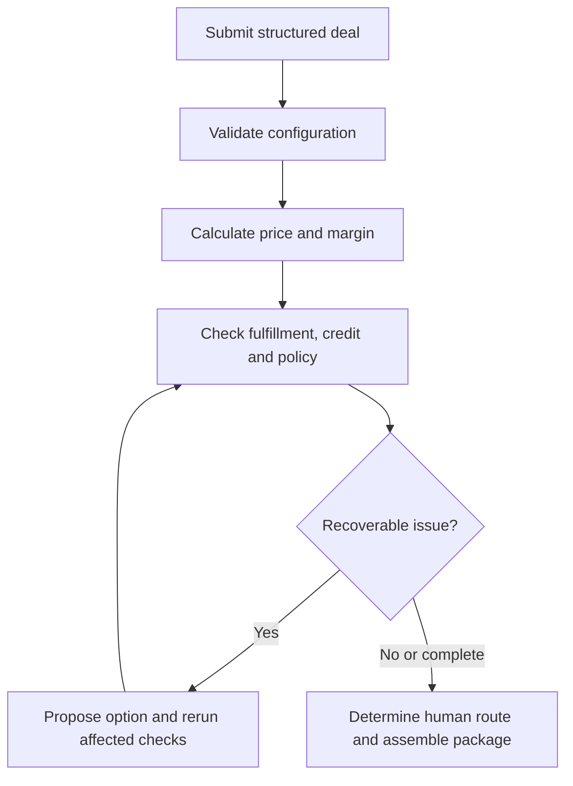

# Deal Desk Orchestrator — thesis project

This private repository is the active source of truth for the thesis. The project is organized into [Phase 1A: literature review](phase-1a-literature-review/README.md), [Phase 1B: agent architecture](phase-1b-agent-architecture/README.md), and [Phase 1C: synthetic data and implementation](phase-1c-data/README.md). New work belongs here; `alialnaggar/dealdeskdata` is a historical portfolio copy.

## Approved roadmap to thesis completion — 4 November 2026

**Status: APPROVED by project owner on 4 November 2026.** This is the active planning direction through the **5 January 2027 thesis submission** and January defense. Dates are targets, not completed results or unconditional commitments. The existing Phase 1A/1B/1C records, Phase 2 technical roadmap, master blueprint, decision log and dated evaluation reports remain the evidence of what was actually implemented. This roadmap does not authorize hosted model calls, source changes or business approvals.

**Current baseline:** Six fixed-result projections and six bounded AI specialist stages have been demonstrated in offline integration; original/candidate separation, evidence checking, restart and reviewer controls have tested coverage. M2.1 has conditional implementation closure; M2.2 original evaluation exit is OPEN. Phase 1C held-out reference answers were 0/36 independently accepted at the last verified review. Prospective hosted campaign authorization, full semantic scoring, model upgrade and the one-correction-turn enhancement are not complete. Do not infer accuracy or provider reliability from passing offline tests.

### Milestones and target dates

| Milestone | Target window | Required deliverable / exit gate |
| --- | --- | --- |
| **M3 — Data and evaluation readiness** | 4–15 Nov | Independently accepted source-first 36-case answers; resolved disagreements and provenance; compatible Phase 1C pin decision; prospective runner, denominators, timing and matched baseline/scorer offline-tested. |
| **M4 — Core engineering closure** | 9–18 Nov | At most one separately checkpointed correction request for eligible fully returned invalid finals; no retry of uncertain sends; negative tests, complete six-specialist regression, reliability-risk disposition. |
| **M5 — Enhancement review and scope freeze** | 16–22 Nov | Cross-specialist enhancement inventory; rank by research value, business value, cost, safety and measurability; approve implement/defer/reject decisions; freeze functionality by **22 Nov**. |
| **M6 — Paid OpenAI API model integration** | 20–29 Nov | Select exact model; provider adapter and six-specialist development compatibility; prompt/model/version, usage, cost and safety budgets; independently authorized hosted pilot and configuration freeze. |
| **M7 — Formal evaluation** | 30 Nov–12 Dec | Predeclared prospective, independently authorized experiment with frozen held-out cohort; accepted-answer scoring, paired same-source supported deterministic baseline, safety/abstention/reliability/latency/cost reporting and limitations. |
| **M8 — Final system and demonstration** | 8–18 Dec | Stable release candidate, reproducible reviewer demonstration, operator/setup guide, final fresh regression, tagged evaluated code and explicit known limitations. |
| **M9 — Thesis submission and defense** | Parallel now–5 Jan; defense Jan | Literature/methodology/architecture/results chapters, diagrams, references, threats to validity, supervisor review, revisions, submission by **5 Jan 2027**, and defense preparation. |

### Acceptance checklist by milestone

**M3 — Phase 1C and evaluation prerequisites**
- [ ] Independently review, resolve and accept the 36 source-first held-out answers; keep answer keys inaccessible to agents.
- [ ] Audit any accepted Phase 1C release against the currently pinned reader; explicitly approve any pin change. Do not silently adopt Credit v3 or controls 040/041.
- [ ] Finish prospective campaign membership/preflight/start and receipt reconciliation integration; retain preflight/no-send and uncertain-send denominators.
- [ ] Finish missing-aware timing and usage capture, independent semantic scoring protocol and matched deterministic baseline eligibility.

**M4 — Governed core engineering**
- [ ] Implement **one maximum correction turn** only after a fully returned, safely correctable deterministic final-output validation rejection; sanitized reason, same authorized evidence, new identity/receipt/budget, unchanged fixed authority.
- [ ] No correction on timeout, HTTP/transport failure, reserved-only/uncertain send, source/subject mismatch, permissions or budget stop. Revalidate once; terminate on second rejection.
- [ ] Test invalid→valid, invalid→invalid, restart, tampering, cross-subject claims, budget stop and no-replay.
- [ ] Review historical Configuration validation, Fulfillment HTTP 400, HTTP 429 and quota risks; do not replay old attempts. Run fresh six-specialist regression and record unresolved limitations.

**M5 — Enhancement review and scope freeze**
- [ ] Review Configuration, Pricing, Fulfillment, Credit, Policy, Routing, orchestration, evidence gaps and reviewer usability.
- [ ] Classify ideas as **implement now**, **defer to future work**, or **reject**; document owner decision, implementation effort, safety impact and measurable research contribution.
- [ ] Consider candidate search, cross-agent coordination, selective reassessment and reviewer explanations only if feasible and governed; WP4 source-writing/V2 remains independently security/source-owner gated.
- [ ] Freeze feature scope by 22 November; late changes require change control and evaluation impact review.

**M6 — Final model integration**
- [ ] Choose paid OpenAI API model and configure an adapter without modifying deterministic business decisions, evidence scope or human authority.
- [ ] Test six specialist tool/typed-final/abstention/error paths on **development** cases, not held-out answer keys.
- [ ] Freeze model/prompt/contract versions and request/token/cost/time ceilings.
- [ ] Review independently trusted campaign authorization, full six-stage manifests and pre-send enforcement; no hosted inference until separately authorized. Historical Groq receipts cannot be enrolled retroactively.

**M7 — Formal evaluation**
- [ ] Freeze prospective case/cohort/eligibility, source pin, model/prompts, correction policy, scorer and baseline **before** execution.
- [ ] Report specialist and end-to-end correctness against independently accepted answers; distinguish label agreement from semantic accuracy.
- [ ] Measure raw and surviving unsupported claims, abstention appropriateness, provider failures/uncertain sends, completion denominators, elapsed time, usage and cost with missing data explicit.
- [ ] Compare only supported, same-case/same-source deterministic baseline capabilities; no invented baseline superiority. Report negative outcomes and threats to validity.
- [ ] Aim to finish formal evaluation by **12 December**; if external dependencies slip, cut optional features rather than weaken evidence standards.

**M8 — Release and demonstration**
- [ ] Show original six-specialist assessment, pinned citations, gaps/abstentions, candidate six-fixed recheck, human-only route and safe failure.
- [ ] Demonstrate checkpoint recovery and audit trail without replaying uncertain requests.
- [ ] Complete reproducible setup, operator guide, fresh regression, release tag and known-limitations statement.
- [ ] A polished enterprise UI or live ERP deployment is **not** a default thesis exit requirement; approve any added UI scope explicitly.

**M9 — Writing and submission**
- [ ] Draft methodology and architecture while engineering continues; write results only from measured evaluation.
- [ ] Finish literature synthesis, design rationale, implementation, experiment, results, limitations, ethics and future work.
- [ ] Complete diagrams, references, supervisor review, final revisions, submission and defense preparation.

### Critical path, freezes and change control

**Critical path:** accepted Phase 1C answers + compatible pin → trusted prospective evaluation readiness and authorization → upgraded-model development pilot → frozen formal evaluation → analyzed thesis results. M3 and M4 can overlap; thesis writing and demonstration preparation run in parallel. External supervisor/security/source-owner approvals must be obtained from the actual authorized people; this roadmap does not grant them.

**Planned freezes:** functional scope by **22 Nov**; model/prompt/source/cohort/evaluation protocol immediately before formal hosted evaluation; evaluated code before final results. If a freeze changes, log the change, affected experiments and necessary reruns.

**Progress reporting:** For each milestone record owner, status (not started / in progress / blocked / verified complete), blockers, last verified commit, tests and evidence links, next action and decision date. Do not mark a gate complete from design documentation alone. Preserve the historical [Phase 2 implementation roadmap](phase-2-implementation/planning/implementation-roadmap.md), [master blueprint](phase-2-implementation/planning/master-implementation-blueprint.md), [M2.2 WP5 audit](phase-2-implementation/evaluation/m22-wp5-evaluation-readiness-and-exit-gate-2026-11-01.md), and [hosted readiness gate](phase-2-implementation/evaluation/m22-hosted-readiness-gate-2026-11-01.md).

# System functionality report

*Design and implementation status checked 11 October 2026.* This report synthesizes the [Phase 1B specification](phase-1b-agent-architecture/agent-architecture-and-deal-flow.md) and [Phase 1C data strategy](phase-1c-data/design/data-strategy.md). **Target design and implemented functionality are different:** see the [Phase 1C release review](phase-1c-data/implementation/phase1c_release_review.md) for dated technical status.

## Purpose and business outcome

A salesperson submits a proposed customer deal. The system checks whether the requested products and options are valid, whether the deal makes commercial sense, whether delivery can be supported, whether customer credit is understood, which company rules apply, and which people must review the result. It produces an **evidence-backed recommendation for human approval**: each important conclusion identifies the data and rule supporting it.

When the original deal has a recoverable problem, the target system may propose a constrained alternative and check it again before showing it to a person. It cannot approve a deal, accept a revised customer quote, waive a hard rule, reserve stock, book production or promise delivery. Its work is *pre-approval assessment and recommendation*; a human chooses whether to correct, seek an exception, approve through the prescribed route or stop.

The intended thesis contribution combines useful specialist proposals, governed coordination, and evaluation of whether agent assistance improves on a fixed-rule workflow. That framing is a synthesis of the design, not a claim of measured improvement.

## Input and output

The incoming deal is **structured**: fields with known meanings, not an open-ended chat. Salesperson comments are supplementary rather than the primary source of requirements. The detailed contract is in Phase 1C's `deals` and `deal_lines` specifications.

| Input area | Examples |
| --- | --- |
| Identity and context | Deal, customer and salesperson IDs; submission time; catalogue and policy versions; currency |
| Requested items | Product/service IDs, quantities, quoted unit prices, selected options and connected bundle groups |
| Commercial terms | Payment terms, contract clauses and exception justification |
| Fulfillment | Requested arrival date, destination, shipping service, partial-delivery permission, digital activation date and installation request where relevant |
| Requirements and evidence | Structured customer/site constraints and references to supporting records |

Discount, full-term total and margin are computed from authoritative inputs and rules. Catalogue-controlled component quantities, technical dependencies and required licences are validated rather than accepted from an unsupported salesperson assertion. Once submitted, the original deal remains unchanged; a selected revision becomes a linked new submission.

The **review package** should contain the original deal, verified specialist findings, rule and evidence references, data freshness, any checked alternative with its tradeoffs, unresolved blockers or assumptions, and the required human review roles and order. If evidence is missing or a hard check fails, the output requests correction, evidence or escalation instead of presenting an ordinary approval-ready route.

## End-to-end flow

Configuration checks first. Pricing uses valid configured lines. Fulfillment, Credit and Policy then run when their actual prerequisites are ready; a policy rule that needs a credit or fulfillment result waits for it. The **Orchestrator** manages this order and compares identities, versions, evidence dates and specialist findings. Approval Routing applies to the *exact* checked original or candidate, after necessary checks have completed.

A candidate is a proposed variant, not a new accepted deal. The planned **typed candidate record** identifies its parent deal, precise changed fields, customer constraints, evidence and as-of time, catalogue/policy/snapshot versions, assumptions, commitment status, checked results and human-readable tradeoff. Search, retries and reruns are bounded. Changed products, prices, quantities, dates or terms invalidate affected earlier results; Routing is always recomputed. A fresh fact requires a separately identified evidence snapshot rather than being silently inserted into an older frozen run.

### Illustrative deal

A customer requests 20 configured workstations by Friday at a quoted unit price. The data supports 12 by Friday and the remainder later. If the customer permits partial delivery and the configured groups remain intact, Fulfillment may propose a split; it could instead propose an offered substitute. Configuration checks the substitute and its component list, Pricing recalculates its value and margin, Fulfillment checks its supply, Credit and Policy reassess affected facts, and Routing determines the human reviewers. The package distinguishes confirmed supply from conditional possibilities and asks for customer choice and human approval. **This example explains the target flow; it is not a claim that the full alternative loop runs today.**

## Six specialist responsibilities and the Orchestrator

A **deterministic check** follows fixed rules and gives the same answer for the same inputs. A specialist's AI capability is useful when it selects authorized evidence, proposes a constrained option or explains a nontrivial problem. Fixed tools verify every hard conclusion. A specialist may be ordinary code if a language model adds no measurable value; separate responsibilities still enable error attribution.

| Component | Required decision or check | Target contribution beyond reporting the rule result |
| --- | --- | --- |
| Configuration Validator | Are products, options, licences, groups and assemblies valid and sellable? | Find an offered compatible correction or substitute, explicitly marking any unmet customer requirement. Recheck the whole affected group and bill of materials (the components needed for an assembly). |
| Pricing & Margin | What are the verified value, discount, cost and margin? | Compare permitted repricing options and explain economic tradeoffs; a tool recalculates every number. |
| Availability, Production & Fulfillment | What quantity is supportable by which date, and is supply confirmed, merely feasible, conditional, unknown or infeasible? | Explore a later date, group-safe partial delivery or substitute without mistaking an offer or unbooked build for a commitment. Digital activation needs matching proof; installation is an eligibility check, not appointment scheduling. |
| Credit & Risk | What is post-deal exposure and what does dated payment evidence show? | Attribute the concern, seek a fresh authorized read when available, and compare a verified revised deal's exposure. It cannot change a limit. |
| Policy & Compliance | Which commercial, payment, contract and exception rules pass, fail or lack evidence? | Explain correctable issues, permitted human-exception paths and evidence requests. It cannot create a waiver from a justification. |
| Approval Routing | Which human roles must review the final checked proposal, and in what order? | Explain each role and open blocker; it cannot grant approval. |
| Orchestrator | What runs next, what must rerun, and are findings consistent? | Coordinate bounded options, handle missing/conflicting evidence, prevent loops, preserve the audit trace and assemble original-versus-option comparisons. It does not calculate domain answers or choose approval authority. |

Credit and Policy stay independent: a favorable customer credit result does not erase a policy violation, and vice versa. Optional historical-deal lookup can give context but cannot override current rules or expose evaluation answers.

## Governance: controls on decisions and evidence

Governance is built into the workflow rather than applied as a final label.

| Control | Intended behavior |
| --- | --- |
| Decision authority | Fixed tools enforce technical compatibility, arithmetic, fulfillment evidence, credit limits, mandatory policy conditions and approval rules. AI cannot overrule them; humans own approval and authorized exceptions. |
| Missing or conflicting facts | A critical unknown, stale record or disagreement is surfaced for refresh, correction or escalation. A favorable result from another specialist cannot hide it. |
| Versioned and dated evidence | A run records its catalogue/policy versions, as-of time and frozen data snapshot. Findings cite rule and evidence IDs. |
| Immutable submissions and safe proposals | Original submitted inputs are retained. Candidate evaluations have no purchase, production, stock, credit-limit or approval side effect. |
| Traceability and accountability | Record agent inputs, outputs, evidence, errors, retries, reruns, model/prompt versions where used, timing and the reason for the recommendation. Credit, Policy, Routing and Orchestration are separately evaluated. |
| Human handoff | A review route identifies roles and order; it is not a record that those people have approved. Hard blockers and unresolved evidence prevent normal sign-off. |

Live-system credentials and permission enforcement need additional security work if Salesforce/Odoo sandbox integration is built. That later integration security is distinct from the decision-governance controls required for the synthetic core.

## Evaluation: how the thesis tests the system

Evaluation means testing on cases with independently prepared expected findings; it is not enough that the system returns a fluent explanation. Independent answer keys must remain hidden from agent-visible data.

1. **Specialist correctness:** arithmetic, rule selection, valid evidence, proper unknowns, false passes, and whether proposed options preserve customer requirements.
2. **Orchestration correctness:** prerequisites and parallelism, candidate identity, changed-field reruns, version/snapshot consistency, conflict handling, correct stopping, retry/loop limits and no unauthorized side effects.
3. **Final package and routing:** correct deal status, complete explanation, no unsupported delivery commitment, required roles and order for the exact checked candidate.
4. **Measured value and efficiency:** useful alternative rate and quality versus the same-case **rule-only baseline**; latency, tool/model calls and cost. A single-generalist comparison is optional if feasible.

Held-out cases should include an option that genuinely helps and a case in which **no safe option exists**. Record hard-rule violations, invented or unsupported alternatives, missed approvers, false delivery promises, unresolved conflicts and trace gaps. More agents are not assumed to be better; the experiment must test whether they add value.

## Current state versus target design

| Area | Status as of 11 October 2026 |
| --- | --- |
| Core data | Phase 1C has a 24-table PostgreSQL schema, structured deal contract and controlled evidence reads. |
| Deterministic foundation | Schema, reference fixtures, reader, rule compilation and deal-decision checks have passed relevant tests. Fourteen reference scenarios establish narrow behavior, not complete independent evaluation. |
| Development data | A 36-deal pilot, 80 customer masters, 400 historical submissions and dated synthetic evidence artifacts exist. The 400-run outcomes are provisional **diagnostics**, not independently reviewed answer keys or training labels. |
| Data/evaluation gaps | Product/component fit and dated comparable price/cost evidence remain review items. The 100 generated tests and separate 36-case evaluation set with independently reviewed findings remain unfinished; `ready_for_generation` is false. |
| Agent runtime | Full six-specialist execution, Orchestrator alternative loop, validated candidate outputs and independent alternative-quality evaluation are not complete. |
| First alternative experiment | Planned: **keep the 24-table schema**, define a typed candidate record and test one shortage → permitted partial delivery or substitute → complete affected-check rerun. The trace will show whether separate correlated runs suffice or a small schema migration is needed. Expanding scenarios and closing fit/price evidence matter more than simply adding rows. |
| Interface and integrations | Submission/review UI, Salesforce and Odoo adapters, and deployment are future work. |

The [Phase 1C README](phase-1c-data/README.md), [readiness plan](phase-1c-data/implementation/phase1c_data_readiness_plan.md) and [release review](phase-1c-data/implementation/phase1c_release_review.md) supersede this dated table as implementation progresses.

## External systems and scope boundary

The core uses reproducible synthetic PostgreSQL data. Optional later adapters may translate authorized Salesforce customer/opportunity/quote fields and configured Odoo product, stock, purchasing, capacity or accounting fields into the same typed deal and evidence contracts. The integration must map external IDs, units, currency, time zones, source ownership, permissions and evidence freshness. The actual Odoo deployment, modules, plan and version determine which access method is available; no live connection or specific API capability is assumed.

The thesis prototype assesses a deal **before** approval. Lead scoring, autonomous purchasing or manufacturing, order creation, invoicing, collection, churn analysis and a general chat-with-ERP agent are outside this core. Production operation with real users, full authentication and hardened live integrations lies beyond the thesis prototype.

## Source documents

- [Phase 1A — literature review and research record](phase-1a-literature-review/README.md); [paper source index](phase-1a-literature-review/research-record/Paper-Source-Index.md).
- [Phase 1B — authoritative agent architecture and deal flow](phase-1b-agent-architecture/agent-architecture-and-deal-flow.md). Its [workflow image](phase-1b-agent-architecture/assets/six-agent-workflow.png) shows the initial assessment path; the written specification includes the newer alternative loop.
- [Phase 1C — data strategy](phase-1c-data/design/data-strategy.md), [implementation and status](phase-1c-data/README.md), and [dated release review](phase-1c-data/implementation/phase1c_release_review.md).
