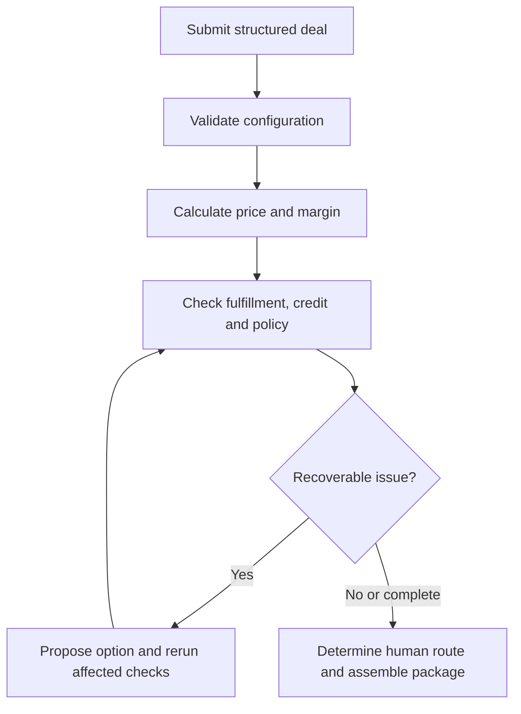

# Deal Desk Orchestrator — thesis project

This private repository is the active source of truth for the thesis. The project is organized into [Phase 1A: literature review](phase-1a-literature-review/README.md), [Phase 1B: agent architecture](phase-1b-agent-architecture/README.md), and [Phase 1C: synthetic data and implementation](phase-1c-data/README.md). New work belongs here; `alialnaggar/dealdeskdata` is a historical portfolio copy.

**Phase 1C update, 12 October 2026:** Ali selected the bounded synthetic fit model. The 36 component specifications are in the draft catalogue and checked across 24 BOMs; a separate repeatable audit now measures provisional price and margin distributions for all 120 sellable products. A read-only bounded margin experiment now compares three policy profiles and quantifies the cost-variation choice; the [calibration decision sheet](phase-1c-data/calibration-decision-sheet.md) lists its evidence and unresolved decision. The six field reviews, two calibration reviews, independent evaluation set and generation gate remain open. Two [evaluation authoring examples](phase-1c-data/evaluation/README.md) demonstrate separation of provisional answer drafts from input facts. A reader-backed development scorer checks two proposals against a provisional draft; zero of the 36 planned answers are independently reviewed. The [draft PR](https://github.com/alialnaggar/DealDeskOrchestrator/pull/1) holds these increments.

**14 October 2026:** The provisional 100-submission regression batch imports from repeatable SQL and runs through the reader and deterministic gate; controlled synthetic provider proof now covers five matching digital cases. It reuses 20 development source templates and is not an independent evaluation distribution. The [as-built Phase 1C synthesis methodology](phase-1c-data/design/synthetic-data-methodology.md) records generation, dated evidence, reproducibility, cohort separation and limits for thesis writing. The separate 36-case evaluation now has 36 database-backed provisional input packets with pinned replay hashes; all independent answer reviews remain pending (0/36). See the [evaluation authoring boundary](phase-1c-data/evaluation/README.md). Calibration and generation readiness remain open.

# System functionality report

*Design and implementation status checked 11 October 2026.* This report synthesizes the [Phase 1B specification](phase-1b-agent-architecture/agent-architecture-and-deal-flow.md) and [Phase 1C data strategy](phase-1c-data/design/data-strategy.md). **Target design and implemented functionality are different:** see the [Phase 1C release review](phase-1c-data/implementation/phase1c_release_review.md) for dated technical status.

## Purpose and business outcome

A salesperson submits a proposed customer deal. The system checks whether the requested products and options are valid, whether the deal makes commercial sense, whether delivery can be supported, whether customer credit is understood, which company rules apply, and which people must review the result. It produces an **evidence-backed recommendation for human approval**: each important conclusion identifies the data and rule supporting it.

When the original deal has a recoverable problem, the target system may propose a constrained alternative and check it again before showing it to a person. It cannot approve a deal, accept a revised customer quote, waive a hard rule, reserve stock, book production or promise delivery. Its work is *pre-approval assessment and recommendation*; a human chooses whether to correct, seek an exception, approve through the prescribed route or stop.

The intended thesis contribution combines useful specialist proposals, governed coordination, and evaluation of whether agent assistance improves on a fixed-rule workflow. That framing is a synthesis of the design, not a claim of measured improvement.

## Input and output

The incoming deal is **structured**: fields with known meanings, not an open-ended chat. Salesperson comments are supplementary rather than the primary source of requirements. The detailed contract is in Phase 1C's `deals` and `deal_lines` specifications.

| Input area | Examples |
| --- | --- |
| Identity and context | Deal, customer and salesperson IDs; submission time; catalogue and policy versions; currency |
| Requested items | Product/service IDs, quantities, quoted unit prices, selected options and connected bundle groups |
| Commercial terms | Payment terms, contract clauses and exception justification |
| Fulfillment | Requested arrival date, destination, shipping service, partial-delivery permission, digital activation date and installation request where relevant |
| Requirements and evidence | Structured customer/site constraints and references to supporting records |

Discount, full-term total and margin are computed from authoritative inputs and rules. Catalogue-controlled component quantities, technical dependencies and required licences are validated rather than accepted from an unsupported salesperson assertion. Once submitted, the original deal remains unchanged; a selected revision becomes a linked new submission.

The **review package** should contain the original deal, verified specialist findings, rule and evidence references, data freshness, any checked alternative with its tradeoffs, unresolved blockers or assumptions, and the required human review roles and order. If evidence is missing or a hard check fails, the output requests correction, evidence or escalation instead of presenting an ordinary approval-ready route.

## End-to-end flow

Configuration checks first. Pricing uses valid configured lines. Fulfillment, Credit and Policy then run when their actual prerequisites are ready; a policy rule that needs a credit or fulfillment result waits for it. The **Orchestrator** manages this order and compares identities, versions, evidence dates and specialist findings. Approval Routing applies to the *exact* checked original or candidate, after necessary checks have completed.

A candidate is a proposed variant, not a new accepted deal. The planned **typed candidate record** identifies its parent deal, precise changed fields, customer constraints, evidence and as-of time, catalogue/policy/snapshot versions, assumptions, commitment status, checked results and human-readable tradeoff. Search, retries and reruns are bounded. Changed products, prices, quantities, dates or terms invalidate affected earlier results; Routing is always recomputed. A fresh fact requires a separately identified evidence snapshot rather than being silently inserted into an older frozen run.

### Illustrative deal

A customer requests 20 configured workstations by Friday at a quoted unit price. The data supports 12 by Friday and the remainder later. If the customer permits partial delivery and the configured groups remain intact, Fulfillment may propose a split; it could instead propose an offered substitute. Configuration checks the substitute and its component list, Pricing recalculates its value and margin, Fulfillment checks its supply, Credit and Policy reassess affected facts, and Routing determines the human reviewers. The package distinguishes confirmed supply from conditional possibilities and asks for customer choice and human approval. **This example explains the target flow; it is not a claim that the full alternative loop runs today.**

## Six specialist responsibilities and the Orchestrator

A **deterministic check** follows fixed rules and gives the same answer for the same inputs. A specialist's AI capability is useful when it selects authorized evidence, proposes a constrained option or explains a nontrivial problem. Fixed tools verify every hard conclusion. A specialist may be ordinary code if a language model adds no measurable value; separate responsibilities still enable error attribution.

| Component | Required decision or check | Target contribution beyond reporting the rule result |
| --- | --- | --- |
| Configuration Validator | Are products, options, licences, groups and assemblies valid and sellable? | Find an offered compatible correction or substitute, explicitly marking any unmet customer requirement. Recheck the whole affected group and bill of materials (the components needed for an assembly). |
| Pricing & Margin | What are the verified value, discount, cost and margin? | Compare permitted repricing options and explain economic tradeoffs; a tool recalculates every number. |
| Availability, Production & Fulfillment | What quantity is supportable by which date, and is supply confirmed, merely feasible, conditional, unknown or infeasible? | Explore a later date, group-safe partial delivery or substitute without mistaking an offer or unbooked build for a commitment. Digital activation needs matching proof; installation is an eligibility check, not appointment scheduling. |
| Credit & Risk | What is post-deal exposure and what does dated payment evidence show? | Attribute the concern, seek a fresh authorized read when available, and compare a verified revised deal's exposure. It cannot change a limit. |
| Policy & Compliance | Which commercial, payment, contract and exception rules pass, fail or lack evidence? | Explain correctable issues, permitted human-exception paths and evidence requests. It cannot create a waiver from a justification. |
| Approval Routing | Which human roles must review the final checked proposal, and in what order? | Explain each role and open blocker; it cannot grant approval. |
| Orchestrator | What runs next, what must rerun, and are findings consistent? | Coordinate bounded options, handle missing/conflicting evidence, prevent loops, preserve the audit trace and assemble original-versus-option comparisons. It does not calculate domain answers or choose approval authority. |

Credit and Policy stay independent: a favorable customer credit result does not erase a policy violation, and vice versa. Optional historical-deal lookup can give context but cannot override current rules or expose evaluation answers.

## Governance: controls on decisions and evidence

Governance is built into the workflow rather than applied as a final label.

| Control | Intended behavior |
| --- | --- |
| Decision authority | Fixed tools enforce technical compatibility, arithmetic, fulfillment evidence, credit limits, mandatory policy conditions and approval rules. AI cannot overrule them; humans own approval and authorized exceptions. |
| Missing or conflicting facts | A critical unknown, stale record or disagreement is surfaced for refresh, correction or escalation. A favorable result from another specialist cannot hide it. |
| Versioned and dated evidence | A run records its catalogue/policy versions, as-of time and frozen data snapshot. Findings cite rule and evidence IDs. |
| Immutable submissions and safe proposals | Original submitted inputs are retained. Candidate evaluations have no purchase, production, stock, credit-limit or approval side effect. |
| Traceability and accountability | Record agent inputs, outputs, evidence, errors, retries, reruns, model/prompt versions where used, timing and the reason for the recommendation. Credit, Policy, Routing and Orchestration are separately evaluated. |
| Human handoff | A review route identifies roles and order; it is not a record that those people have approved. Hard blockers and unresolved evidence prevent normal sign-off. |

Live-system credentials and permission enforcement need additional security work if Salesforce/Odoo sandbox integration is built. That later integration security is distinct from the decision-governance controls required for the synthetic core.

## Evaluation: how the thesis tests the system

Evaluation means testing on cases with independently prepared expected findings; it is not enough that the system returns a fluent explanation. Independent answer keys must remain hidden from agent-visible data.

1. **Specialist correctness:** arithmetic, rule selection, valid evidence, proper unknowns, false passes, and whether proposed options preserve customer requirements.
2. **Orchestration correctness:** prerequisites and parallelism, candidate identity, changed-field reruns, version/snapshot consistency, conflict handling, correct stopping, retry/loop limits and no unauthorized side effects.
3. **Final package and routing:** correct deal status, complete explanation, no unsupported delivery commitment, required roles and order for the exact checked candidate.
4. **Measured value and efficiency:** useful alternative rate and quality versus the same-case **rule-only baseline**; latency, tool/model calls and cost. A single-generalist comparison is optional if feasible.

Held-out cases should include an option that genuinely helps and a case in which **no safe option exists**. Record hard-rule violations, invented or unsupported alternatives, missed approvers, false delivery promises, unresolved conflicts and trace gaps. More agents are not assumed to be better; the experiment must test whether they add value.

## Current state versus target design

| Area | Status as of 11 October 2026 |
| --- | --- |
| Core data | Phase 1C has a 24-table PostgreSQL schema, structured deal contract and controlled evidence reads. |
| Deterministic foundation | Schema, reference fixtures, reader, rule compilation and deal-decision checks have passed relevant tests. Fourteen reference scenarios establish narrow behavior, not complete independent evaluation. |
| Development data | A 36-deal pilot, 80 customer masters, 400 historical submissions and dated synthetic evidence artifacts exist. The 400-run outcomes are provisional **diagnostics**, not independently reviewed answer keys or training labels. |
| Data/evaluation gaps | Product/component fit and dated comparable price/cost evidence remain review items. The 100 generated tests and separate 36-case evaluation set with independently reviewed findings remain unfinished; `ready_for_generation` is false. |
| Agent runtime | Full six-specialist execution, Orchestrator alternative loop, validated candidate outputs and independent alternative-quality evaluation are not complete. |
| First alternative experiment | Planned: **keep the 24-table schema**, define a typed candidate record and test one shortage → permitted partial delivery or substitute → complete affected-check rerun. The trace will show whether separate correlated runs suffice or a small schema migration is needed. Expanding scenarios and closing fit/price evidence matter more than simply adding rows. |
| Interface and integrations | Submission/review UI, Salesforce and Odoo adapters, and deployment are future work. |

The [Phase 1C README](phase-1c-data/README.md), [readiness plan](phase-1c-data/implementation/phase1c_data_readiness_plan.md) and [release review](phase-1c-data/implementation/phase1c_release_review.md) supersede this dated table as implementation progresses.

## External systems and scope boundary

The core uses reproducible synthetic PostgreSQL data. Optional later adapters may translate authorized Salesforce customer/opportunity/quote fields and configured Odoo product, stock, purchasing, capacity or accounting fields into the same typed deal and evidence contracts. The integration must map external IDs, units, currency, time zones, source ownership, permissions and evidence freshness. The actual Odoo deployment, modules, plan and version determine which access method is available; no live connection or specific API capability is assumed.

The thesis prototype assesses a deal **before** approval. Lead scoring, autonomous purchasing or manufacturing, order creation, invoicing, collection, churn analysis and a general chat-with-ERP agent are outside this core. Production operation with real users, full authentication and hardened live integrations lies beyond the thesis prototype.

## Source documents

- [Phase 1A — literature review and research record](phase-1a-literature-review/README.md); [paper source index](phase-1a-literature-review/research-record/Paper-Source-Index.md).
- [Phase 1B — authoritative agent architecture and deal flow](phase-1b-agent-architecture/agent-architecture-and-deal-flow.md). Its [workflow image](phase-1b-agent-architecture/assets/six-agent-workflow.png) shows the initial assessment path; the written specification includes the newer alternative loop.
- [Phase 1C — data strategy](phase-1c-data/design/data-strategy.md), [implementation and status](phase-1c-data/README.md), and [dated release review](phase-1c-data/implementation/phase1c_release_review.md).

## Model review draft checkpoint — 14 October 2026

All 36 pinned provisional inputs now have separately reasoned model drafts covering the six responsibilities (216 findings). See the [review protocol, source pins, saved outputs and unresolved observations](phase-1c-data/evaluation/reviews/model_review_record.md). The fresh-context reviewer was instructed to use source/provider facts only, without authoring intent or system outcomes. This was an instruction boundary with the inherited model configuration, not verified cross-model independence or expert review. The saved first pass and disclosed self-check corrections support later methodology reporting.

Structural validation checks the 72 source/provider hashes, completeness and evidence pointers; it cannot certify answer correctness. The model missed the age of capacity observations in 017–018. Freshness thresholds, cost-source precedence, gate/routing meanings and service-rule scope require substantive adjudication. Inputs and draft findings are preserved rather than silently aligned with system outcomes. CI validates the saved drafts against freshly exported facts, separately from the blank template and source-only artifact.

**36 model drafts; 0/36 accepted independent answers.** The blank reviewer template remains empty; these answer drafts must remain outside future system inputs/tools. No baseline scoring, schema change or calibration freeze is authorized by this checkpoint. Six field marks, two calibration reviews and `ready_for_generation=false` remain. The next gate is substantive verification and explicit decisions on the recorded ambiguities, followed by versioned re-review if facts/contracts change.

## Evaluation contract audit and pending decisions — 14 October 2026

A new source-only audit verifies all 72 packet/provider hashes, calculates timestamp ages and matches procurement offers to the same product's standard cost. Under the current reader's 24-hour comparison, only cases 005/006 (inventory 49/61 hours) and 017/018 (capacity 51/52 hours) lie outside the window. Ten offer-bearing cases contain the same arbitrary EUR 47.50 offer; the finished-product cost is EUR 2,386.20 in six cases, while four component cases have EUR 50/240 standards. These are facts for adjudication, not inferred expected outcomes. The audit never reads model findings or calls the decision engine; CI repeats it against freshly exported inputs and preserves the full report as a separate reviewer artifact.

The [decision proposal](phase-1c-data/evaluation/reviews/evaluation_contract_decisions.md) gives exact proposed freshness/term conventions, offer replacements and costing precedence, gate meanings, service-rule scope and escalation mapping. **Ali's decision is pending.** Current implementation behavior is disclosed after first-pass drafting, so it cannot be mistaken for independent ground truth. No input, first-pass answer, master price/cost, schema, calibration or readiness flag is changed. There are still 36 model drafts and **0/36 accepted independent answers**; six field marks, two calibration reviews and `ready_for_generation=false` remain. If approved, the next step is versioned inputs and renewed source-based review before acceptance/scoring.

## Approved evaluation input version 2 — 14 October 2026

Ali explicitly approved the contract proposal (F1, C1/C2, G1, S1 and R1) for a second review. The [approved fictional business contract](phase-1c-data/implementation/phase1c_evaluation_business_contract.json) is now part of each version-2 source packet and the generator source fingerprint: 24-hour snapshots, seven-day provider verification, explicit digital term convention, standard-cost pricing precedence, gate meanings, regional service scope and routing boundaries. This declares simulation assumptions; it does not claim external calibration or approve deals.

Only ten evaluation offer costs change: EUR 2,386.20 in 007–012, EUR 50.00 in 015–016 and EUR 240.00 in 019–020. An executable before/after check proves all other authored rows remain identical apart from the configuration fingerprint. All provider records are unchanged. Version 1 definitions, manifest, index and blank template are retained under `evaluation/archive/v1`; its original 36 model drafts are preserved and validated against a separate version-1 PostgreSQL replay. They are not rebound to changed facts. The current index/template refer to version 2, whose source-definition digest is `1b7e0dffb3eaae8ee7c7e4bcd82aba0d55da11321198ce8c54e1581fae6740cc`.

Local source checks pass; database replay is delegated to GitHub PostgreSQL CI because this workspace has no PostgreSQL driver/server. Version 2 awaits renewed source-based model drafting and substantive verification. These are revisions of the same 36 cases, not 72 independent evaluation samples. **Accepted independent answers remain 0/36.** No master price/cost, historical/pilot/100-case source, schema or calibration parameter changed; six field marks, two calibration reviews and `ready_for_generation=false` remain.

The first version-2 database replay exposed incidental BOM row-order variation after the archived cohort was loaded. Version 2 now sorts selected source arrays and rule arrays by canonical JSON before packet/source hashing; no facts are added, removed or changed. A row-permutation test verifies this, and the exporter implementation joins the generator source fingerprint. The original version-1 export format and evidence pointers are preserved. Diagnostic packets from all 36 PostgreSQL reads match the normalized preparation; a new fresh CI replay must confirm the current pin.
