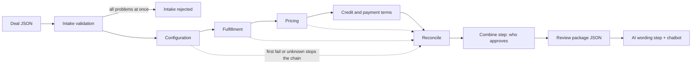
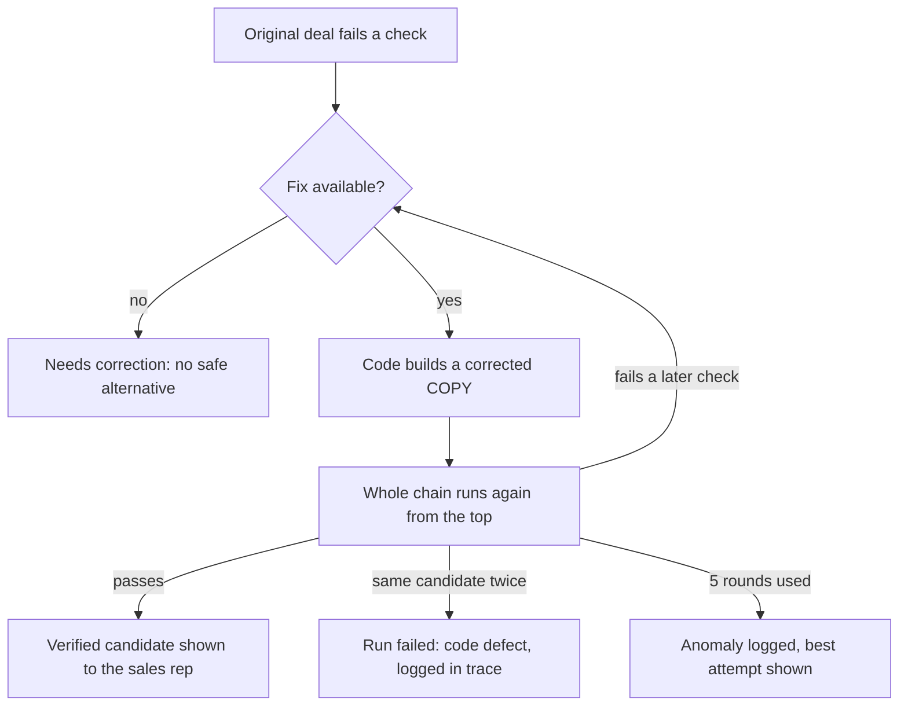

# Deal Desk Orchestrator

**Live prototype (mock data): [dealdeskdemo.duckdns.org](https://dealdeskdemo.duckdns.org)**

A governed pre-approval assessment of B2B sales deals. A salesperson submits one deal as JSON; four rule checks decide whether it can go to approval, what must be corrected, or what cannot be confirmed; a repair loop builds and re-checks corrected copies; the result is a referenced review package that names exactly who must act. Language models only word the result and answer questions about it. **The system is complete and correct with AI switched off.**

> Bachelor thesis project by Ali Alnaggar, Business Informatics, German International University (GIU), Cairo. In progress. The source code, company data and test deals are in a private repository and are available on request until the front end is ready for people to test. This page describes the design, the stack and the current status.

## The problem
In an enterprise technology provider, a quote with discounts, custom configuration, delivery dates, credit terms and contract changes is checked by hand against many rules and many people. This is slow, inconsistent and hard to audit. The project asks two questions:

1. Which deal-desk decisions need deterministic rules, which allow bounded language-model reasoning, and how do the two affect constraint compliance, escalation accuracy, latency and cost?
2. Do orchestration-level trace metrics reveal processing failures that final-output accuracy alone does not show?

## What the system does

- **Intake** validates the JSON (types, ids, options, dates, payment days, advance, contract changes) and reports **all** problems at once from fixed templates, with no AI.
- **Four checks, in order, plain code:** Configuration (eligibility, requires/excludes, contract changes), Fulfillment (stock, inbound supply, workshop capacity, digital pools, lead times), Pricing (discount ladder, margin floor per category, deal value), Credit and payment terms (exposure, overdue invoices, payment days). The chain **stops at the first failing or unknown check**; later checks are "not assessed".
- **Three outcomes:** ready for approval, needs correction, cannot confirm. Two separate states: intake rejected and run failed. A check can also pass with an approval needed (an approvable exception) without stopping the chain.
- **Cannot confirm** is reserved for real-world uncertainty (stale operational data, unconfirmed supply, no rule row that applies). The system never guesses a missing fact.
- **Combine step** (code): keeps only the highest sales role, removes duplicates, and orders Sales, Finance Director, Legal Counsel, each with the reason, the numbers and the references.
- **Review package:** JSON first (the single source of truth); any page is a view of it. Every number and statement carries a reference to the rule, the record and the formula it came from.

## The repair loop

Every fix that changes the deal is built **by code**, never by a model, and re-checked through the **whole** chain, because a fix in one place can break an earlier or later check. Examples of fix builders: lower a discount to the cap or to the margin floor; shorten payment days to the standard maximum or the cap; split a delivery from stock plus a confirmed inbound or from a second warehouse; switch to the other offered option of a built product; add a required product; a minimum advance payment `a = 1 - (credit limit - existing exposure) / deal value`, offered only if `a <= 50%` and not when the customer is already over the limit. Finance and Procurement actions (collect overdue invoices, limit review, order a shortfall) are action lines, not candidate deals. Loop limit: 5 (the number of checks plus one).

## Key rules (illustrative regional profiles)
| Rule | Germany (looser profile) | Egypt (strict profile) |
| --- | --- | --- |
| Discount: Sales Director above / VP Sales above / nobody above | 10% / 20% / 35% | 5% / 15% / 25% |
| Margin band under the category floor (VP Sales) | 2 points | 1 point |
| Deal value: Sales Director above / VP Sales above | 100k / 300k | 50k / 150k |
| Credit exception band over the limit (Finance Director) | 15% | 5% |
| Payment days: standard maximum / cap | 30 / 60 | 45 / 90 |

Exposure = unbilled commitments + open invoices + deal value x (1 - advance %). Overdue above 5% of the credit limit fails. Stock, capacity and pool snapshots are fresh for 24 hours; the unbilled-commitment figure for 7 days. The two profiles are modelling assumptions, not claims about the countries.

## Engineering controls
- **One trace:** an append-only event log with times and durations per run; the run record, run summary and research metrics are views of it.
- **Checkpointing and automatic resume** with LangGraph's PostgreSQL saver; a run that crashes resumes without repeating finished steps; model calls are reserved before they are sent, so a crash cannot send twice.
- **Immutable original and identity checks:** the run identity (deal, data snapshot, rule set, code commit) is frozen and re-checked at every step; evidence is sealed with a SHA-256 digest.
- **Read-only database access** on the assessment path; corrected copies live in a separate slot.
- **Typed contracts** between steps; reconcile marks a missing check result as "run failed", never as "cannot confirm".
- **Grounding:** the wording step and the chatbot may only use references that exist in the package; numbers are checked by code; outputs that fail validation are rejected and counted (a research measure).
- **Default-deny tool scope** for the chatbot's single what-if tool, with its own call cap.

## Where AI is used (and where it is not)
- Checks, fixes, numbers, approvals and the order of approvers: **code only**.
- One shared wording step after all code steps (recommendation text, drafted messages, "what changed"), with a scripted fallback that makes the system work with AI off.
- A chatbot over a finished package: Q&A with validated references ("not in this package" otherwise); later a what-if tool that re-runs a corrected copy through the same chain.
- AI never approves, waives a rule, computes an authoritative number, reserves stock or promises delivery.

## Company data and test deals
A synthetic enterprise technology provider, rebuilt from specification files by builder scripts and checked by checkers that read the **loaded** rows: 24 PostgreSQL tables, 14 customers in two sales regions, six delivery destinations, 12 shipping lanes, one fixed business date with all other dates relative to it, and six deliberately designed, documented gaps (for example a product category with no margin floor, a destination without coverage rules, a stale stock record, a stale credit figure) whose correct answer is "cannot confirm". The data is frozen and fingerprinted; **107 test deals** (as JSON) cover every check, every rule zone, the boundaries of the main limits, intake rejection, the orchestrator cases and three showcase deals: *the full repair* (fails all four checks in turn and passes after four verified candidate rounds), *the honest system* (cannot confirm, with an owner named) and *clean with approvals*.

See [`examples/sample-review-package-full-repair.json`](examples/sample-review-package-full-repair.json): a real package from a development run (synthetic data). It shows the header, outcome, action list, the candidate with its round log, findings per check and the run record.

## Evaluation design
- **Expected answers** are derived from the frozen data and the rules by a separate script that never sees system output, reviewed by the author, and stored where the system cannot read them (answer-key isolation). The thesis states which parts were prepared with AI assistance.
- **Runs:** rule-only baseline; with AI (repeated 3 times, pass^k); fault runs (crash and resume, repeated candidate, loop limit, missing result).
- **Measures:** constraint compliance, escalation accuracy, stopping-check accuracy, approver correctness, latency and cost per round, share of AI outputs rejected by validation, and trace metrics against final-output accuracy (research question 2).

## Front-end prototype
A clickable review console with mock data is in [`docs/`](docs/PROTOTYPE.md): open [`docs/index.html`](docs/index.html) locally, or use the live page at [dealdeskdemo.duckdns.org](https://dealdeskdemo.duckdns.org). It shows the deal queue, intake validation, the run screen with repair rounds, the review package and the chat drawer. The production front end is rebuilt on the real system in December.

## Technology
Python 3.12 · FastAPI and Uvicorn (assessment API; Pydantic only at the API edge) · PyYAML · LangGraph 1.2 with PostgresSaver · PostgreSQL 16 with psycopg 3 · a plain-Python rule engine (no framework) · unittest (hundreds of tests, including checkpoint-resume tests on a real database) · GitHub Actions CI · Groq-hosted `openai/gpt-oss-120b` for the wording step and chatbot, behind a replaceable adapter · front end being rebuilt (React). LangChain is not used.

## Status (26 Nov 2026)
Data frozen; intake, the four checks, the candidate loop, combine step, review package, one trace with automatic resume and the scoring harness are built and tested; first full run over the 107 test deals completes without crashes (99 assessed, 8 intake rejections by design). Next: scoring against the independent expected answers, the wording step and chatbot, the evaluation runs, the rebuilt front end, and the thesis text (final submission 5 Jan 2027).

## Contact
Code is available on request until the front end is ready for public testing.
