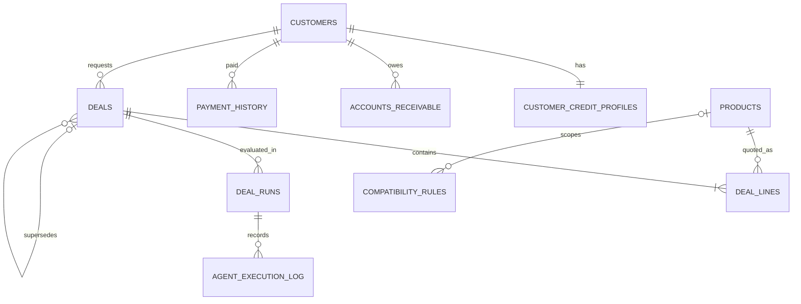
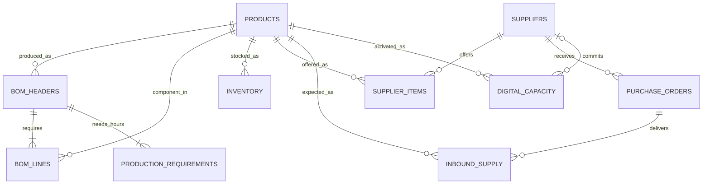

> **Status note (11 October 2026):** This document preserves the design and its dated progress history. The current implementation status is in `../README.md` and `../implementation/phase1c_release_review.md`. Later dated sources and 400-cutoff replay supersede statements below that operational rows are pending. Historical diagnostics are not training labels. Section 19 records the 11 October agent-capability extension and its data impact; this is a target design, not implemented agent behavior.

# Deal Desk Orchestrator — Phase 1C: Data Strategy

**Student:** Ali Alnaggar
**Thesis:** Deal Desk Orchestrator (Multi-Agent System)
**Created:** 20 September 2026
**Last updated:** 11 October 2026 (Section 19; historical status below retained)
**Status (5 October execution update):** Simplified 24-table Schema V2 supports six agents, pre-order fulfillment and replayable runs. Synthetic operational values and the revised 100-case test mix remain proposed in `calibration_config.yaml`; commercial profile numbers are accepted for controlled simulation. Schema, smoke, 14 row fixtures, reader comparisons, policy compilation and full commercial decision checks passed in GitHub Actions. The deterministic deal gate returns seven attributed decision sections, including compatibility; these are not seven agents. It withholds a review route when evidence or fulfillment is unresolved. The first 14-run gate check exposed a stale test expectation (six sections instead of seven); commit `35fd271` corrected it, and [Actions run 37290252824](https://github.com/alialnaggar/dealdeskdata/actions/runs/37290252824) passed all checks. Digital proof uses an optional controlled synthetic manifest. Full agent/Orchestrator execution, operational synthetic rows and independent evaluation cases remain pending. Data generation remains gated on calibration review.

**Decision trail:** `Phase1C-calibration-and-validation-rationale.md` records the seven steps after agent-to-table design, why public references and synthetic assumptions were used, how the three policy thresholds and clean/conflict cases were chosen, and what the 14 scenarios establish. `Phase1C-schema-visualization.md` shows all 24 tables in six areas, with separate foreign-key and business-lookup diagrams.

---

## 0. Why this file exists / why we approached it this way

Before writing a single agent, we needed to answer: **where does the data agents check against actually come from?** This matters more than it looks, because a wrong choice here quietly breaks the whole system later — either agents get built against data that doesn't have the fields they need, or (worse) the data itself contradicts the rules the agents are supposed to enforce.

We considered two options and picked one deliberately:

- **Option A — find and edit an existing public dataset** (e.g. from Kaggle) to fit the project
- **Option B — build a synthetic data generator from scratch**, using a real dataset only to calibrate realistic numbers

**We chose Option B.** The reasoning, in order of how much it mattered:

1. **No public dataset covers the governance layer, period.** In the earlier seven-component framing, five included facts companies rarely publish — credit limits, discount policy, approval hierarchy, product compatibility rules, and historical approval decisions. That's confidential-by-nature data. So a public dataset could never fully supply the governance layer. The newer BOM, supplier, resource and shipment needs strengthen the case for a purpose-built synthetic dataset.

2. **Editing external data creates contradictions we'd have to spend time reconciling instead of avoiding.** Concretely: Tableau Superstore, a fictional learning dataset, contains extreme discounts and negative-profit rows. If we imported it and then wrote a policy rule like "discounts over 30% need VP approval," many imported historical deals would instantly become policy violations that were apparently approved by nobody — because that data was never generated under our rules. The Deal History precedent tool would then return nonsense. Fixing that after the fact costs more time than generating consistent data would have cost from the start.

3. **Building from scratch gives us the one thing editing a dataset can't: engineered edge cases, on demand.** The evaluation chapter depends on deliberately having a "pricing says fine, policy says violation" deal, a "customer over credit limit but great payment history" deal, a "stock shortage vs. requested delivery date" deal, etc. Real data won't reliably contain the exact situations we need to measure — a generator with a conflict-injection parameter will produce them intentionally.

4. **A parameterized generator is itself a reusable thesis artifact.** Once written, we can regenerate 50 deals or 5,000 deals in seconds, tune the % of deals that should trigger each kind of exception, and hand the generator to anyone (supervisor, examiner) to reproduce our exact test conditions. Editing a static CSV once gives none of that.

5. **Real data still matters — calibration and modelling references, not row import.** We are not inventing the catalogue or numeric distributions blindly. Public datasets will be used to measure plausible ranges and distributions for quantities, discounts, margins, order values, stock and delivery timing. Official enterprise-technology catalogues will be used to validate category names, product archetypes, common attributes and bundling patterns. We take the *structure, ranges and relationships*, not the source rows.

6. **Synthetic does not mean arbitrary.** Product and customer names will be fictional so the thesis does not pretend to reproduce a real company's confidential catalogue. However, naming conventions, product families, attributes, price bands and category proportions will be based on observed real-world patterns. Every adopted assumption will be recorded in the calibration configuration or accompanying notes.

So the approach is best summarized as: **fully synthetic data, grounded in observed commercial data where available, real product catalogues, and clearly labelled official sample databases, generated by a script we control end-to-end** — not "find a dataset and adapt it," and not "make up numbers with no grounding" either.

---

## 1. Core principle

**Schema first, dataset second.** The data shape is defined by what the 6 agents need (Phase 1B, Section 3) — not by what happens to be available on Kaggle. We design the tables our agents require, then fill them with generated data calibrated against real sources. We never bend agent design to fit an available dataset's columns.

---

## 2. Per-agent data requirements

| Agent | Necessary evidence | Calibration boundary |
|---|---|---|
| Configuration Validator | Sellable catalogue, selected configuration and group, compatibility, effective BOM/version | Real catalogues guide archetypes; exact internal rules/BOMs are synthetic. |
| Pricing & Margin | Product price/cost, quote quantities and terms, discounts, category floors; assembled standard-cost roll-up | Public anchors and integrator gross margin check; assembly costs remain synthetic. |
| Availability, Production & Fulfillment | Free finished and component stock after aggregate allocations; confirmed receipts vs supplier offers; BOMs; capability/day capacity; digital activation evidence; installation eligibility; destination and shipping lane | Existing delivery data is only a loose reference; operational parameters need explicit synthetic calibration. |
| Credit & Risk | Verified full-term deal value, credit limit, current AR, payment history, dated aggregate unbilled commitments | Confidential governance values synthetic; current snapshot cannot replay old credit states. |
| Policy & Compliance | Terms, Pricing output and policy rules; verified domain findings only where an explicit rule depends on them | Internal rules synthetic; separate from Credit and Fulfillment. |
| Approval Routing | Final independent agent findings, mandatory role rules and ordered approvals | Role authority synthetic; hard blocks cannot be waived. |
| Orchestrator and optional Deal History tool | Structured agent traces and historical deals/outcomes with labels hidden from evaluated agents | Execution data generated at runtime; precedents must be baseline-policy consistent. |

---

## 3. Schema V2 decision: 24 tables for pre-order fulfillment

The 14-table V1 design covered catalogue, sales, credit, policy, current stock and dated inbound supply. Phase 1B requires stock, component procurement, assembly capability and shipment checks. V2 **retains those 14 logical tables and adds 10**, for **24 operational tables**. The PostgreSQL DDL has been executed in disposable test databases, but no generated operational rows have been loaded. Existing commitments are represented by dated aggregate allocated quantities/hours; a proposed deal is evaluated in memory without becoming a commitment. This deliberately supports day-level feasibility, not a factory schedule or simultaneous reservation guarantee.

| Domain | Tables | Decision supported |
|---|---|---|
| Product/configuration | `products`, `compatibility_rules`, `bom_headers`, `bom_lines` | Validate sellability, bundle membership, assembly versions and material quantities. |
| Customer/credit | `customers`, `customer_credit_profiles`, `accounts_receivable`, `payment_history` | Compute independently attributable exposure and payment risk. |
| Commercial governance | `pricing_rules`, `policy_rules`, `approval_rules` | Price, enforce constraints and select approval roles independently. |
| Supply | `inventory`, `inbound_supply`, `suppliers`, `supplier_items`, `purchase_orders` | Subtract aggregate existing allocations from on-hand and incoming supply; distinguish confirmed receipts from offers. |
| Production | `production_requirements`, `production_capacity` | Test ordered assembly steps against net free equipment/workforce hours by day, without modelling individual jobs. |
| Digital | `digital_capacity` | Check activation capacity, lead time, supplier commitment and evidence by edition/region/term. |
| Shipping | `shipping_lanes` | Convert completion into an earliest supportable arrival date. |
| Deal/system | `deals`, `deal_lines`, `deal_runs`, `agent_execution_log` | Preserve immutable submissions, policy replay, independent outputs and audit evidence. |

The nine-category **120-product target counts sellable offerings**. The operational proposal adds **36** non-sellable component `products` rows with distinct identifiers, costs and inventory, subject to BOM coverage checks; proposed total product rows are **156**. Existing 80-customer and 400-historical-deal targets remain proposed. No external dataset supplies the production plan; its assumptions are labelled synthetic.

### 3.1 The quote input that the schema must support

A submitted `deals` record identifies customer, salesperson code (without an employee table), submission time, `catalog_version`, original `policy_set_code` and EUR currency. Deal-level fields include destination, requested physical arrival date where relevant, shipping service, payment terms in days, optional contract months, structured clause codes, `allow_partial_delivery`, exception justification, structured customer requirements and evidence/document references. Each `deal_lines` record identifies product, full-term billable quantity, quoted unit price, product-level selected options, optional digital activation date and per-line installation request; `fulfillment_group_code` marks indivisible bundles. An optional deal-type code is introduced only if it changes a workflow or evaluation rule. Discounts, totals and margins are calculated, never independent manual inputs. No milestone-payment schedule or installer date/capacity scheduler is in the MVP. Missing or contradictory required fields fail Configuration; an unavailable optional evidence field is labelled unknown/conditional according to the affected rule, never invented. Customer address is only a default, not a substitute for the submitted destination.

### 3.2 What changes in the original 14 tables

The V1 field descriptions later in Section 4 remain valid **except for the explicit changes here**:

| Table | V2 field/constraint changes | Reason |
|---|---|---|
| `products` | Add `is_sellable`, `fulfillment_mode`, `stock_uom`, technical `catalog_version` and unique `(product_code, catalog_version)`; components may have zero list price but positive cost. | Route stocked, made-to-order, digital and service items and select immutable versioned product facts. |
| `compatibility_rules` | Support `scope_type` (`line`, `configured_group`, `whole_deal`), product-level installation eligibility, required service/licence and structured configuration conditions. | Avoid unrelated-line incompatibility and check installation by product and service region. |
| `customer_credit_profiles` | Add nonnegative `unbilled_committed_amount`, `commitments_as_of_at`, `commitment_evidence_ref` and documented inclusion/exclusion contract. | Include other commitments without a commitment-owner table; avoid double counting AR or the current quote. |
| `inventory` | Retain `quantity_on_hand` and `snapshot_at`; add nonnegative `quantity_allocated` with `quantity_allocated <= quantity_on_hand`. | Free stock = on-hand minus already allocated, without reservation-owner generation. |
| `inbound_supply` | Add nullable `purchase_order_id` FK, `confirmed_at`, nonnegative `quantity_allocated <= quantity`, and commitment evidence/validity. | Free dated inbound = total minus already allocated; an offer is not a confirmed PO. |
| `deals` | Add `salesperson_id`, `supersedes_deal_id` nullable self-FK, destination/shipping, validated terms/requirements/evidence references. Submitted deals are immutable; edit by new linked deal. | Identify ownership and avoid overwriting an evaluated submission. |
| `deal_lines` | Add `fulfillment_group_code`, optional `requested_activation_date` for digital items and `installation_requested` per line; require configuration needed for BOM/entitlement selection. | Check physical, digital and installation paths without order-level configuration shortcuts. |
| `approval_rules` | Conditions may match `fulfillment_exception_type`, partial-delivery proposal and revised date; do not replace independent Credit/Policy findings. | Escalate logistics exceptions by the configured policy. |
| `agent_execution_log` | Make `run_id` an FK to `deal_runs` and retain structured attempts, evidence/flags, timestamps and prompt/model versions; policy/catalog versions are authoritative in `deal_runs`. | Attribute every attempt to one frozen execution context without duplicating mutable run metadata. |

Pricing uses full-term billable quantity for recurring units. For assembled products, `standard_cost` is generated from component cost, scrap, direct capability-hour cost and declared overhead; the generator checks its BOM cost roll-up within tolerance. Pricing and Credit use the same full quoted value. Credit exposure uses contemporaneous receivables plus the dated aggregate *unbilled* commitment snapshot, excluding amounts already in AR and the proposed deal. The snapshot records evidence/limits, but cannot itemize or reconstruct historical commitments.

### 3.3 Ten added tables: fields, keys and necessity

All monetary values use `NUMERIC`, quantities appropriate `NUMERIC` for divisible material or `INTEGER` for countable units, UTC timestamps plus the operational local timezone, and strict FK/check constraints. No table below is populated yet.

| # | Table | Required fields and keys | Why an existing table cannot replace it |
|---:|---|---|---|
| 15 | `bom_headers` | `bom_id` PK; `finished_product_id` FK; `catalog_version`; `bom_version`; `configuration_signature_json`; `output_quantity`; `effective_from`, `effective_to`; `status`. Unique applicable product/configuration/version; positive output quantity and non-overlapping active effective periods per selection. | A configured finished product can have several versioned assembly recipes. A product's free-form attributes cannot express dated, auditable component consumption. |
| 16 | `bom_lines` | `bom_line_id` PK; `bom_id` FK; `component_product_id` FK; `required_quantity_per_output`; `scrap_pct`; `substitute_group_code` nullable; `priority`; `is_mandatory`. Positive requirements, nonnegative scrap, no circular or self-referential BOM. | One finished unit requires several components; substitute choices must be technically validated rather than assumed equivalent. |
| 17 | `suppliers` | `supplier_id` PK; name/code unique; `country_code`; `status`; `order_calendar_json`. | Supplier identity is shared by many item offers and POs; it must not be repeated inconsistently on each receipt. |
| 18 | `supplier_items` | `supplier_item_id` PK; `supplier_id` and `product_id` FKs; supplier SKU; `minimum_order_qty`, `order_multiple`; lead days `min/mode/max`; `unit_cost`, `currency_code`, `valid_from/to`, `is_active`. Unique supplier/product/valid offer. | Describes **possible procurement** and cost/lead-time assumptions. An offer is not a purchase order or confirmed inbound supply. |
| 19 | `purchase_orders` | `purchase_order_id` PK; `supplier_id` FK; reference unique; `ordered_at`, `confirmed_at` nullable; `status` (`Draft`, `Placed`, `Confirmed`, `Delayed`, `Cancelled`, `Received`); `destination_location_id`. Each inbound row references its PO where applicable; status/date agreement is enforced. | A PO is a supplier commitment covering possibly multiple dated receipts. It supplies evidence that an inbound quantity is genuinely confirmed. |
| 20 | `production_requirements` | `requirement_id` PK; `bom_id` FK; `operation_seq`; `capability_code`; `resource_type` (`equipment`, `workforce`); `setup_hours`, `hours_per_unit`, `batch_size`; `status`. Unique `(bom_id, operation_seq, capability_code, resource_type)`; nonnegative duration, positive batch size. Multiple rows may express equipment and labor needed by the same ordered step. | The BOM lists *materials*, not assembly/test hours or capabilities. |
| 21 | `production_capacity` | `capacity_id` PK; `location_id`, `capability_code`, `resource_type`, `capacity_date`, `time_zone`; `available_capacity_hours` net planned downtime/nonworking time; `allocated_capacity_hours` already committed work; `snapshot_at`, `status`, evidence reference. Unique location/capability/type/day/snapshot; `0 <= allocated <= available`. | Gives date-specific free hours by needed capability, without individual machine, calendar, job or job-operation rows. |
| 22 | `digital_capacity` | `digital_capacity_id` PK; `product_id` FK; `configuration_signature_json` for exact edition; `provider_id` nullable FK → `suppliers`; `region_code`, `term_code`, `capacity_unit`, `capacity_total`, `quantity_allocated`, `activation_lead_days`, `commitment_status`, `confirmed_at`, `valid_until`, `snapshot_at`, `evidence_ref`. Nonnegative, allocated <= total, exact-match dimensions and effective evidence. | Entitlements/activations are neither warehouse stock nor physical inbound supply. Confirmation needs free capacity and a valid binding provider commitment; an offer remains conditional. |
| 23 | `deal_runs` | `run_id` UUID PK; `deal_id` FK; `original_policy_set_code`, `applied_policy_set_code`, `catalog_version_used`; `as_of_at`, `data_snapshot_ref`, `input_snapshot_json`, `config_hash`, `run_status`, `started_at`, `completed_at`. Run snapshots are immutable once started; no evaluation answer in agent-visible data. | Multiple baseline/lenient/strict executions of one immutable deal need distinct versioned, auditable contexts. |
| 24 | `shipping_lanes` | `lane_id` PK; `origin_location_id`, `origin_time_zone`; `destination_country_code`, `destination_region`; `shipping_service_code`; `transit_workdays`; `dispatch_weekdays_json`; `cutoff_local_time`; `is_active`. Unique applicable origin/destination/service; nonnegative transit time; valid IANA origin timezone. | Production/receipt day is not the customer's physical arrival date; the origin timezone is required to apply a local dispatch cutoff. |

Use existing `products` for finished and component SKUs and `inventory` for both stock types. `purchase_orders` is a supplier-commitment *header*, not a proposed new purchase; its `inbound_supply` children already supply item, quantity, location and dated ETA, so a separate PO-line table is unnecessary for this pre-order check. There is no stock-movement ledger, employee table, machine/worker schedule, factory job, or automatic procurement/approval action. Those would belong to a later stateful execution system.

Allocated stock/inbound/capacity are synthetic snapshots of existing commitments; they need a stated source, freshness time and invariant, not fabricated owner links to generated deals. Received quantities move into a newer stock snapshot and leave inbound eligibility. A confirmed PO may have multiple dated receipt rows consistent with header supplier/status/confirmation; without PO-line quantities the MVP cannot independently reconcile the original purchase quantity. Aggregates must not be added again from deal rows. Historical credit replay requires historical snapshots, not today's AR and commitment totals.

### 3.4 Cross-table constraints and calculation contract

1. **Configuration first:** select one effective BOM for each assembled configuration and verify required components/substitutes and indivisible groups. Reject ambiguous or missing BOMs; do not use another unrelated line as a required component.
2. **Current stock:** `free_stock = quantity_on_hand - quantity_allocated` at one valid product/location snapshot. Hold allocations for *all lines of the currently evaluated deal* in an in-memory simulation; do not mutate snapshots. Existing aggregate allocations must not also be subtracted from deal rows.
3. **Confirmed receipts:** `free_inbound = quantity - quantity_allocated` on valid dated receipts, only with supplier commitment and ETA effective by the candidate date; cancelled, received/already-stocked and offer-only rows do not count. Delays use re-confirmed ETAs. Do not count allocations twice.
4. **Material need:** explode selected BOM quantities and scrap by build quantity; group shared components by location and date across proposed lines, consume once in simulation and check substitutes explicitly. Existing work is already reflected in allocated stock, inbound and capacity; do not subtract it again.
5. **Production:** for each BOM `operation_seq`, compute resource-hours (setup by batch plus quantity × hours per unit), check required equipment/workforce capabilities against `available_capacity_hours - allocated_capacity_hours` for the relevant day, and consume candidate hours in memory. Respect operation order at day precision (same-day sequence only if the daily convention permits it); no exact hourly scheduling is claimed. Material availability by that day is a separate prerequisite. Proposed production is **uncommitted**.
6. **Physical delivery:** compare free finished goods, free confirmed inbound and feasible built quantities by date; add dispatch/transit to obtain arrival, respect partial-delivery permission and indivisible groups, and never imply stock/capacity has been reserved.
7. **Digital and installation:** digital confirmation requires exact edition/region/term/unit, free entitlement, valid binding provider commitment and activation lead time. Supplier offers or unsupported dates are `conditional`/`unknown`. Installation checks only product and destination service-area eligibility (yes/no/unknown); no crew booking or installation date is promised.
8. **Evidence/status:** return `available_now`, `confirmed_by_date`, `feasible_uncommitted`, `conditional`, `unknown`, or `infeasible`, with quantity/date/bottleneck/evidence per line/group. Missing required identifiers/rules block; optional stale evidence may justify only a labelled conditional option where safe; contradictory authoritative facts remain unknown/escalated. Commercial approval cannot waive physical impossibility.
9. **Isolation and orchestration:** Fulfillment, Credit and Policy retain separate structured outputs and error labels. Pricing supplies one verified full-commitment value to Credit and Policy. Policy waits on another domain only if an explicit rule references that domain. Approval Routing unions required roles after findings; hard blocks remain hard.

### 3.5 Reference scenario that every implementation must explain

A customer asks for ten configured servers by a specified date. Two are free in finished stock after aggregate allocation; the other eight need a selected BOM. A component has allocated existing demand; free confirmed PO receipts cover part of the gap, while an offer yields only **conditional** replenishment. Assembly labor might need `1 + 10 × 0.5 = 6` hours; if its capacity row has 16 available and 12 allocated hours, only 4 remain that day. Test later days and equipment/test capability separately, then add shipping time and indivisible-group constraints. Feasible production remains uncommitted. A real accepted order would require an external execution system to update a later snapshot (e.g. 8 → 10 allocated hours); this Deal Desk does not update it. Two separately evaluated quotes may therefore see the same spare hours, and neither receives a guarantee. Credit and Policy still decide independently.

---

## 4. Detailed field specification of the 14 retained tables

The ten new tables have their field-level specification in Section 3.3. The retained tables below use the explicit V2 amendments in Section 3.2. The types below are PostgreSQL-oriented. IDs may be generated as readable synthetic codes (`PROD-001`, `CUST-001`, `DEAL-0001`) rather than UUIDs because readable IDs make the demo and debugging easier. Monetary fields use `NUMERIC`, never floating point.

### 4.1 `products`

**Why the table is necessary:** This is the product master used by Configuration, Pricing, and Availability. It provides stable product identity, sellability, list price, cost, and flexible product characteristics.

| Field | Suggested type | Why it is needed |
|---|---|---|
| `product_id` | `VARCHAR`, PK | Stable internal identifier and target of deal, inventory, supply, and configuration foreign keys. |
| `product_code` | `VARCHAR`, NOT NULL | Business-facing SKU; unique together with `catalog_version`. |
| `catalog_version` | `VARCHAR`, NOT NULL | Selects immutable product price, cost and attributes with the technical catalogue. |
| `product_name` | `VARCHAR`, NOT NULL | Human-readable label in the UI and final deal package. |
| `category` | `VARCHAR`, NOT NULL | Allows category-level pricing, margin, policy, and precedent comparisons. |
| `product_type` | `VARCHAR`, NOT NULL | Distinguishes physical products, software, subscriptions, and services; inventory checks apply only where relevant. |
| `list_price` | `NUMERIC(14,2)`, NOT NULL | Baseline used to calculate line discount and gross sales value. |
| `standard_cost` | `NUMERIC(14,2)`, NOT NULL | Required to calculate gross margin amount and percentage. |
| `attributes_json` | `JSONB`, NOT NULL default `{}` | Stores variable attributes such as edition, maximum users, capacity, or service tier without adding columns for every product type. |
| `billing_model` | `VARCHAR`, NOT NULL | One-time, recurring subscription, usage-based or fixed-service-fee for sellable products; `not_applicable` for non-sellable components. |
| `unit_of_measure` | `VARCHAR`, NOT NULL | Defines what one quoted unit means, such as `device`, `user_year`, `instance_month`, `protected_tb_month`, `service_package`, or `coverage_year`; without it, quantity and list price are ambiguous across hardware, subscriptions, and services. |
| `is_active` | `BOOLEAN`, NOT NULL | Retains inactive/discontinued records without making them usable for new requests. |
| `is_sellable` | `BOOLEAN`, NOT NULL | Prevents a component SKU from appearing as a quoted customer-facing line. |
| `fulfillment_mode` | `VARCHAR`, NOT NULL | Selects stocked, supplier-finished, make-to-order, digital, scheduled-service or component path. |
| `stock_uom` | `VARCHAR`, NOT NULL | Provides physical units for inventory and BOM quantities; `not_applicable` for purely digital/service offerings. |

Important constraints: `list_price >= 0`, `standard_cost >= 0`, `standard_cost > 0` for stocked components, positive list price for active sellable items, and unique `(product_code, catalog_version)`. The nine-category count excludes non-sellable component rows, which use a separate component category and `component_unit` commercial unit. Validate that sellable physical units can be mapped to BOM output/stock units; unsupported usage-based price computation fails validation instead of guessing. Margin is **not stored** because it depends on quoted price and quantity.

### 4.2 `compatibility_rules`

**Why the table is necessary:** Product data alone cannot say that Add-on X requires Enterprise Edition, that two products conflict, or that a configuration field is mandatory. This table makes the Configuration Validator configurable rather than hard-coded.

| Field | Suggested type | Why it is needed |
|---|---|---|
| `compatibility_rule_id` | `VARCHAR`, PK | Stable identifier for the rule and for explaining which rule failed. |
| `catalog_version` | `VARCHAR`, NOT NULL | Selects the applicable technical catalogue/configuration-rule version. Commercial policy changes must not alter technical compatibility. |
| `rule_name` | `VARCHAR`, NOT NULL | Human-readable rule label for audit output. |
| `rule_type` | `VARCHAR`, NOT NULL | `requires_product`, `excludes_product`, `attribute_constraint`, `required_deal_field` or `installation_eligibility` (product/destination/service-area conditions). |
| `scope_type` | `VARCHAR`, NOT NULL | `line`, `configured_group` or `whole_deal`; unrelated quote lines must not become an assembly. |
| `source_product_id` | `VARCHAR`, nullable FK → `products.product_id` | Product that activates the rule; nullable for a global required-field rule. |
| `target_product_id` | `VARCHAR`, nullable FK → `products.product_id` | Product required or excluded by the source product; unused for other rule types. |
| `condition_json` | `JSONB`, NOT NULL | Holds structured operands, operators and configuration signature for attribute and field checks. |
| `severity` | `VARCHAR`, NOT NULL | Distinguishes blocking errors from warnings. |
| `message` | `TEXT`, NOT NULL | Exact business explanation returned when the rule fails. |
| `priority` | `INTEGER`, NOT NULL | Makes evaluation deterministic when several rules apply. |
| `is_active` | `BOOLEAN`, NOT NULL | Allows a rule to be disabled without deleting it. |

At least the fields required by `rule_type` must be present. For example, `requires_product` needs both source and target products. Conditions must be structured JSON, not natural-language rules that the LLM has to guess how to execute.

### 4.3 `customers`

**Why the table is necessary:** This is the customer/account master. General segmentation belongs here; financial risk data is separated so the Credit Agent can query it explicitly.

| Field | Suggested type | Why it is needed |
|---|---|---|
| `customer_id` | `VARCHAR`, PK | Stable account identifier referenced by deals and all credit records. |
| `customer_code` | `VARCHAR`, UNIQUE, NOT NULL | Business-facing identifier used to validate incoming deal requests. |
| `customer_name` | `VARCHAR`, NOT NULL | Human-readable name in the UI and output package. |
| `size_segment` | `VARCHAR`, NOT NULL | Classifies the organization as SMB, Mid-Market, or Enterprise for plausible deal-size, credit and precedent distributions. |
| `strategic_account` | `BOOLEAN`, NOT NULL default `FALSE` | Separates commercial importance from company size; a strategic account is a relationship designation, not a fourth size segment. |
| `industry` | `VARCHAR`, NOT NULL | Adds realistic context and supports future precedent filtering. |
| `country_code` | `CHAR(2)`, NOT NULL | Records customer geography without introducing a country table. |
| `region` | `VARCHAR`, NOT NULL | Supports regional approval or policy rules if used. |
| `customer_since` | `DATE`, NOT NULL | Gives useful context for customer tenure and synthetic realism. |
| `account_status` | `VARCHAR`, NOT NULL | Stops inactive, suspended, or blocked accounts from passing configuration/credit checks. |

### 4.4 `customer_credit_profiles`

**Why the table is necessary:** A customer record does not by itself describe credit capacity. Separating the one-to-one credit profile keeps credit logic clear and allows the Credit Agent to distinguish a customer’s identity from its financial standing.

| Field | Suggested type | Why it is needed |
|---|---|---|
| `customer_id` | `VARCHAR`, PK and FK → `customers.customer_id` | Enforces exactly one current credit profile per customer. |
| `credit_limit` | `NUMERIC(14,2)`, NOT NULL | Baseline against which post-deal exposure is compared. |
| `unbilled_committed_amount` | `NUMERIC(14,2)`, NOT NULL | Existing commitments not yet in AR, excluding the proposed deal. |
| `commitments_as_of_at` | `TIMESTAMPTZ`, NOT NULL | Freshness of the aggregate snapshot. |
| `commitment_evidence_ref` | `VARCHAR`, NOT NULL | Documented source; no per-deal ownership audit is claimed. |
| `risk_rating` | `VARCHAR`, NOT NULL | Existing internal assessment used as one input, not as the agent’s final answer. |
| `credit_status` | `VARCHAR`, NOT NULL | Represents operational states such as Active, On Hold, or Blocked. |
| `default_payment_terms_days` | `INTEGER`, NOT NULL | Lets Policy/Credit compare requested terms with the customer’s normal terms. |
| `last_review_date` | `DATE`, NOT NULL | Shows how current the credit assessment is. |
| `next_review_date` | `DATE`, nullable | Indicates when a new assessment is due. |

Current exposure = unpaid AR + unbilled committed amount; post-deal adds the verified proposed value. The aggregate must exclude AR overlap and the current proposal, and cannot also be recalculated from included deal rows. Exposure/utilization remain derived. Missing or stale commitment evidence is `unknown`, not zero.

### 4.5 `accounts_receivable`

**Why the table is necessary:** The Credit Agent needs current unpaid and overdue balances. A single exposure number would hide the evidence and make overdue analysis impossible.

| Field | Suggested type | Why it is needed |
|---|---|---|
| `receivable_id` | `VARCHAR`, PK | Unique current receivable record. |
| `customer_id` | `VARCHAR`, FK → `customers.customer_id`, NOT NULL | Connects the invoice to the customer being assessed. |
| `invoice_number` | `VARCHAR`, UNIQUE, NOT NULL | Traceable synthetic invoice reference. |
| `invoice_date` | `DATE`, NOT NULL | Establishes invoice age. |
| `due_date` | `DATE`, NOT NULL | Determines whether the outstanding balance is overdue. |
| `original_amount` | `NUMERIC(14,2)`, NOT NULL | Shows the starting obligation. |
| `outstanding_amount` | `NUMERIC(14,2)`, NOT NULL | Amount that contributes to current exposure. |
| `status` | `VARCHAR`, NOT NULL | Open, Partially Paid, Overdue, or Paid; should be consistent with amount and dates. |
| `as_of_date` | `DATE`, NOT NULL | Makes the point-in-time snapshot reproducible. |

Constraints: amounts must be non-negative, `outstanding_amount <= original_amount`, and `due_date >= invoice_date`.

### 4.6 `payment_history`

**Why the table is necessary:** Current AR cannot show whether a customer usually pays on time. This table enables the intended edge case: a customer may exceed its credit limit while still having a strong historical payment record.

| Field | Suggested type | Why it is needed |
|---|---|---|
| `payment_id` | `VARCHAR`, PK | Unique historical payment record. |
| `customer_id` | `VARCHAR`, FK → `customers.customer_id`, NOT NULL | Groups historical payment behavior by customer. |
| `invoice_number` | `VARCHAR`, NOT NULL | Keeps the payment traceable to a synthetic invoice. |
| `invoice_date` | `DATE`, NOT NULL | Supports payment-cycle analysis. |
| `due_date` | `DATE`, NOT NULL | Baseline for determining lateness. |
| `paid_date` | `DATE`, NOT NULL | Used to calculate days early/late. |
| `invoice_amount` | `NUMERIC(14,2)`, NOT NULL | Allows weighted payment-behavior measures if desired. |
| `paid_amount` | `NUMERIC(14,2)`, NOT NULL | Confirms whether the invoice was fully or partially settled. |

The agent derives average days late, percentage paid on time, and frequency of serious lateness. Labels such as “strong payer” should not be pre-stored.

### 4.7 `pricing_rules`

**Why the table is necessary:** List price alone cannot model volume discounts, customer-segment pricing, or category margin floors. Pricing rules describe what the company normally offers; they are separate from policies that say what is prohibited or requires escalation.

| Field | Suggested type | Why it is needed |
|---|---|---|
| `pricing_rule_id` | `VARCHAR`, PK | Stable identifier for audit explanations. |
| `policy_set_code` | `VARCHAR`, NOT NULL | Selects the applicable commercial pricing-policy configuration without changing the underlying deal facts. |
| `rule_name` | `VARCHAR`, NOT NULL | Human-readable description. |
| `rule_type` | `VARCHAR`, NOT NULL | Volume Discount, Segment Discount, Category Margin Floor, etc. |
| `scope_type` | `VARCHAR`, NOT NULL | Identifies whether the rule is global, product-, category-, or segment-specific. |
| `scope_value` | `VARCHAR`, nullable | Stores the relevant product ID, category, or segment when the rule is not global. |
| `condition_json` | `JSONB`, NOT NULL | Structured trigger such as quantity ≥ 100. |
| `action_json` | `JSONB`, NOT NULL | Structured result such as standard discount 8% or margin floor 25%. |
| `priority` | `INTEGER`, NOT NULL | Resolves overlapping rules deterministically. |
| `is_stackable` | `BOOLEAN`, NOT NULL | States whether multiple discounts can be combined. |
| `is_active` | `BOOLEAN`, NOT NULL | Disables a rule without deleting it. |

### 4.8 `policy_rules`

**Why the table is necessary:** A commercially reasonable price can still violate policy. This separation creates the planned conflict case in which Pricing reports a healthy margin while Policy reports that the discount exceeds delegated authority.

| Field | Suggested type | Why it is needed |
|---|---|---|
| `policy_rule_id` | `VARCHAR`, PK | Stable identifier for the violation and audit trail. |
| `policy_set_code` | `VARCHAR`, NOT NULL | Selects the applicable commercial policy configuration. |
| `rule_name` | `VARCHAR`, NOT NULL | Human-readable label. |
| `policy_area` | `VARCHAR`, NOT NULL | Pricing, Margin, Payment, Contract, Credit, or other governed area. |
| `scope_type` | `VARCHAR`, NOT NULL | Global, category, segment, region, etc. |
| `scope_value` | `VARCHAR`, nullable | Narrows the rule when it is not global. |
| `condition_json` | `JSONB`, NOT NULL | Structured violation condition such as payment terms > 60 days. |
| `severity` | `VARCHAR`, NOT NULL | Warning, Exception, or Blocker. |
| `required_action` | `VARCHAR`, NOT NULL | Continue with warning, request exception, escalate, or reject. |
| `explanation_template` | `TEXT`, NOT NULL | Consistent business explanation for the final package. |
| `priority` | `INTEGER`, NOT NULL | Ensures deterministic evaluation order. |
| `is_active` | `BOOLEAN`, NOT NULL | Allows controlled activation. |

### 4.9 `inventory`

**Why necessary:** On-hand stock for finished products and components at a location and snapshot time. Free stock subtracts an aggregate of previously allocated stock; individual owners cannot be audited in this MVP.

| Field | Type | Reason |
|---|---|---|
| `inventory_id` | `VARCHAR`, PK | Stable snapshot record. |
| `product_id` | `VARCHAR`, FK → `products.product_id` | Component or finished SKU. |
| `location_id` | `VARCHAR`, NOT NULL | Physical fulfillment/production location code. |
| `quantity_on_hand` | `NUMERIC(14,3)`, NOT NULL | Physical stock in `products.stock_uom`. |
| `quantity_allocated` | `NUMERIC(14,3)`, NOT NULL | Existing commitments, excluding the proposal. |
| `snapshot_at` | `TIMESTAMPTZ`, NOT NULL | Prevents future/past supply from being silently mixed with current on-hand stock. |

Enforce `0 <= quantity_allocated <= quantity_on_hand` and unique `(product_id, location_id, snapshot_at)`; select the latest valid snapshot not after the run's `as_of_at`. Stale evidence cannot produce a confirmed promise.

### 4.10 `inbound_supply`

**Why necessary:** Each dated receipt is a separate record for one product/location; multiple deliveries can jointly cover a shortage. Only confirmed commitments on or before a candidate date contribute to confirmed available-to-promise.

| Field | Type | Reason |
|---|---|---|
| `supply_id` | `VARCHAR`, PK | Receipt identity and audit link. |
| `purchase_order_id` | `VARCHAR`, nullable FK → `purchase_orders.purchase_order_id` | Connects a supplier commitment to its PO; nullable only for a documented pre-existing commitment. |
| `product_id` | `VARCHAR`, FK → `products.product_id` | Component or finished item. |
| `location_id` | `VARCHAR`, NOT NULL | Expected receiving location. |
| `quantity` | `NUMERIC(14,3)`, NOT NULL | Positive amount in stock unit. |
| `quantity_allocated` | `NUMERIC(14,3)`, NOT NULL | Portion already allocated to other demand. |
| `expected_date` | `DATE`, NOT NULL | Latest supplier-confirmed ETA where status permits counting. |
| `confirmed_at` | `TIMESTAMPTZ`, nullable | Evidence that commitment preceded evaluation time. |
| `status` | `VARCHAR`, NOT NULL | `Planned`, `Confirmed`, `Delayed` or `Cancelled`; delayed requires reconfirmed ETA before counting. |
| `reference_number` | `VARCHAR`, UNIQUE, NOT NULL | Synthetic supplier/receipt trace. |
| `evidence_ref` | `VARCHAR`, nullable | Supports a documented pre-existing commitment without a PO. |
| `valid_until` | `TIMESTAMPTZ`, nullable | Expiry/recheck time for confirmation. |

Enforce `0 <= quantity_allocated <= quantity`. Do not count a receipt already incorporated into on-hand, a cancelled/expired row or an unconfirmed offer. Status must agree with its PO. Dated inbound rows already provide item/quantity/date detail: no PO-line table is required for this pre-order model.

### 4.11 `deals`

**Why the table is necessary:** This is the deal header: one customer request, its delivery requirement, commercial terms, data role, and — for historical records only — final outcome. Product lines are separated because a deal can contain several products.

| Field | Suggested type | Why it is needed |
|---|---|---|
| `deal_id` | `VARCHAR`, PK | Stable identifier used across all agents and logs. |
| `supersedes_deal_id` | `VARCHAR`, nullable self-FK → `deals.deal_id` | A correction creates a new immutable submission linked to its predecessor. |
| `customer_id` | `VARCHAR`, FK → `customers.customer_id`, NOT NULL | Connects the deal to customer, credit, AR, and payment evidence. |
| `salesperson_id` | `VARCHAR`, NOT NULL | Sales owner code; no separate salesperson table for MVP. |
| `deal_name` | `VARCHAR`, NOT NULL | Human-readable label in the interface/package. |
| `catalog_version` | `VARCHAR`, NOT NULL | Selects the technical catalogue/configuration rules used to validate the requested products. |
| `policy_set_code` | `VARCHAR`, NOT NULL | Selects the commercial pricing, policy and approval configuration used for the deal. |
| `currency_code` | `CHAR(3)`, NOT NULL default `EUR` | Makes the monetary unit explicit even though the MVP uses one currency. |
| `submitted_at` | `TIMESTAMP`, NOT NULL | Provides a reproducible evaluation timestamp. |
| `requested_delivery_date` | `DATE`, nullable if no physical line | Customer-required physical arrival date after fulfillment and shipping. |
| `destination_country_code` | `CHAR(2)`, NOT NULL | Determines applicable shipping lane; customer address is only a default. |
| `destination_region` | `VARCHAR`, NOT NULL | Refines shipping/service eligibility. |
| `shipping_service_code` | `VARCHAR`, NOT NULL | Selects the quoted dispatch/transit service. |
| `terms_json` | `JSONB`, NOT NULL default `{}` | Validated `payment_terms_days`, optional `contract_months`, `contract_clause_codes`, `allow_partial_delivery`; milestone schedules deferred. Payment method is not collected because no agent decision uses it. |
| `exception_justification` | `TEXT`, nullable | Required for configured commercial exceptions, but never proof that a blocker is waived. |
| `requirements_json` | `JSONB`, NOT NULL default `{}` | Structured customer/site requirements where a rule needs them; supplementary comments stay supplementary. |
| `evidence_refs_json` | `JSONB`, NOT NULL default `[]` | Validated document identifiers/metadata and evidence type, not copied document contents. |
| `deal_status` | `VARCHAR`, NOT NULL | Draft, Submitted, Under Review, Approved, Rejected, or Cancelled; also identifies open deals contributing to exposure. |
| `dataset_type` | `VARCHAR`, NOT NULL | `historical`, `generated_test`, or `evaluation`; prevents accidental mixing during evaluation. |
| `historical_decision` | `VARCHAR`, nullable | Actual Approved/Rejected result for historical deals only; null for unseen evaluation deals. |
| `decision_reason` | `TEXT`, nullable | Supports precedent explanations for historical decisions. |
| `approved_by_roles_json` | `JSONB`, nullable | Stores the actual historical approving role(s) and order without adding approver/history tables. |

For evaluation deals, all historical outcome fields must be null and hidden from agent queries. This is essential to prevent label leakage.

`deal_type` is deferred unless a specific workflow/evaluation rule uses it. Once Submitted, deal inputs cannot be overwritten. The proposed `dataset_type` controls tool visibility; evaluation answer keys live separately from operational tables.

### 4.12 `deal_lines`

**Why the table is necessary:** A deal can contain many products. Each line has its own quantity, quote, and configuration, so it cannot be stored safely in the deal header.

| Field | Suggested type | Why it is needed |
|---|---|---|
| `deal_line_id` | `VARCHAR`, PK | Unique line identifier. |
| `deal_id` | `VARCHAR`, FK → `deals.deal_id`, NOT NULL | Groups lines under one deal. |
| `line_number` | `INTEGER`, NOT NULL | Preserves display/order and provides a clear reference in issues. |
| `product_id` | `VARCHAR`, FK → `products.product_id`, NOT NULL | Connects the requested item to product, pricing, and supply data. |
| `quantity` | `INTEGER`, NOT NULL | Required by Configuration, Pricing, and Availability. |
| `quoted_unit_price` | `NUMERIC(14,2)`, NOT NULL | Sales-proposed price used to calculate discount, net value, and margin. |
| `configuration_json` | `JSONB`, NOT NULL default `{}` | Requested edition, capacity, options and stable configuration signature used for compatibility/BOM selection. |
| `fulfillment_group_code` | `VARCHAR`, nullable | Links indivisible configured/bundled lines; null only for independent lines. |
| `requested_activation_date` | `DATE`, nullable | Customer date for digital entitlement activation, not physical arrival. |
| `installation_requested` | `BOOLEAN`, NOT NULL default `FALSE` | Requests product/region eligibility check only; no installer appointment or capacity check. |

Use unique `(deal_id, line_number)`. Quantity must be positive. Requested discount is derived from product list price and quoted unit price rather than stored redundantly.

### 4.13 `approval_rules`

**Why the table is necessary:** Agent findings do not themselves identify who has authority. This table converts deal value, discount, margin, credit, availability, and policy flags into required approval roles and sequence.

| Field | Suggested type | Why it is needed |
|---|---|---|
| `approval_rule_id` | `VARCHAR`, PK | Stable identifier for routing explanations. |
| `policy_set_code` | `VARCHAR`, NOT NULL | Selects the applicable commercial approval-policy configuration. |
| `rule_name` | `VARCHAR`, NOT NULL | Human-readable route condition. |
| `condition_json` | `JSONB`, NOT NULL | Structured condition over independent agent findings, including discount, credit and delivery/partial-fulfillment exceptions. |
| `required_role` | `VARCHAR`, NOT NULL | Role whose signature is required, such as Sales Director or Finance Director. |
| `approval_sequence` | `INTEGER`, NOT NULL | Orders multiple required approvals. |
| `is_mandatory` | `BOOLEAN`, NOT NULL | Identifies whether the approval can be waived. |
| `priority` | `INTEGER`, NOT NULL | Resolves overlapping routing rules deterministically. |
| `is_active` | `BOOLEAN`, NOT NULL | Allows controlled activation. |

The MVP routes to roles rather than named individuals. This is sufficient to evaluate routing correctness and avoids building an employee directory unrelated to the thesis contribution.

### 4.14 `agent_execution_log`

**Why the table is necessary:** It is not business master data; it is the evidence that the multi-agent system actually executed. It supports traceability, retry analysis, orchestration-path analysis, error measurement, and parallel-versus-sequential latency evaluation.

| Field | Suggested type | Why it is needed |
|---|---|---|
| `execution_id` | `BIGSERIAL`, PK | Unique record for one agent attempt. |
| `run_id` | `UUID`, FK → `deal_runs.run_id`, NOT NULL | Groups attempts under one frozen execution context. |
| `deal_id` | `VARCHAR`, FK → `deals.deal_id`, NOT NULL | Connects the run to the evaluated deal. |
| `agent_name` | `VARCHAR`, NOT NULL | Identifies Configuration, Pricing, Availability, Credit, Policy, Approval, or Orchestrator. |
| `attempt_number` | `INTEGER`, NOT NULL | Distinguishes original execution from retry. |
| `started_at` | `TIMESTAMP`, NOT NULL | Required for timing and execution-order reconstruction. |
| `completed_at` | `TIMESTAMP`, nullable | Required for duration; null while running or after abrupt failure. |
| `status` | `VARCHAR`, NOT NULL | Running, Success, Failed, Retried, or Skipped. |
| `input_snapshot_json` | `JSONB`, NOT NULL | Records the exact structured facts provided to the agent for reproducibility. |
| `output_json` | `JSONB`, nullable | Stores the agent’s validated structured output. |
| `reasoning_summary` | `TEXT`, nullable | Stores concise business justification and cited facts — not private chain-of-thought. |
| `flags_json` | `JSONB`, nullable | Stores warnings, exceptions, and detected conflicts. |
| `error_message` | `TEXT`, nullable | Supports failure diagnosis and retry evaluation. |
| `model_name` | `VARCHAR`, nullable | Makes model-dependent experiments reproducible. |
| `prompt_version` | `VARCHAR`, nullable | Connects outcomes to the prompt definition used. |
| `applied_policy_set_code` | `VARCHAR`, NOT NULL | Denormalized trace label, required to agree with its authoritative `deal_runs` row. |
| `catalog_version_used` | `VARCHAR`, NOT NULL | Denormalized trace label, required to agree with its `deal_runs` row. |
| `latency_ms` | `INTEGER`, nullable | Convenient measured duration for evaluation; should agree with timestamps. |

The unique logical attempt key is `(run_id, agent_name, attempt_number)`.

---

## 5. Derived values and decision outputs

Never store a second mutable copy of a value calculated from authoritative rows. Compute line list/net value, discount/margin, full quoted commitment, overdue AR, post-deal exposure, free stock and inbound, exploded BOM demand, free capability/day hours, candidate production day, digital activation feasibility and shipping-adjusted arrival. The approval route derives from finalized outputs and `approval_rules`. Store agent findings/evidence in `agent_execution_log`, not master rows.

For sellable recurring products, line quantity is the full number of billable units across the committed term (for example, three monthly instances for twelve months means 36 `instance_month` units). `standard_cost`, `list_price` and `quoted_unit_price` share that unit. Proposed purchase/schedule options remain simulations until a real order commits them. All availability calculations state their `as_of_at`, relevant time zone and policy/catalog versions.

### 5.1 Fulfillment output contract

Return, per line and indivisible group: `requested_quantity`, `quantity_by_requested_date`, `earliest_full_date` where supportable, partial quantities/dates, source path, `fulfillment_status` (`available_now`, `confirmed_by_date`, `feasible_uncommitted`, `conditional`, `unknown`, `infeasible`), bottleneck type/ID, assumptions, evidence IDs and warning/error codes. For digital lines, `requested_activation_date` and commitment evidence replace physical shipping; for installation requests, return product/region eligibility `yes`/`no`/`unknown` separately. A feasible day is not a reservation; a supplier offer is not a confirmed commitment.

## 6. Agent-to-data trace and dependency check

| Component | Reads from V2 tables or verified predecessor output | Output/ownership |
|---|---|---|
| Configuration Validator | `deals`, `deal_lines`, `products`, `compatibility_rules`, effective `bom_headers`/`bom_lines` for configured assemblies | Validity, normalized group/configuration, applicable BOM ID or precise missing/conflicting rule; hard gate. |
| Pricing & Margin | Validated deal plus `products`, `pricing_rules`, selected BOM cost roll-up and commercial-unit contract | Verified full deal value, per-line and deal discount/margin, floor findings. |
| Availability, Production & Fulfillment | Validated lines/BOM; `inventory`, `inbound_supply`, `suppliers`, `supplier_items`, `purchase_orders`, `production_requirements`, `production_capacity`, `digital_capacity`, `shipping_lanes`; installation eligibility from `compatibility_rules` | Day-level physical feasibility, digital activation, installation eligibility, confidence, bottlenecks and alternatives. |
| Credit & Risk | Verified Pricing deal value plus `customer_credit_profiles` (dated unbilled commitments), `accounts_receivable`, `payment_history` | Credit limit, exposure and payment indicators; independent credit finding without double counting commitments. |
| Policy & Compliance | Validated terms and Pricing findings plus `policy_rules`; verified Credit/Fulfillment outputs only when a policy condition explicitly depends on them | Rule IDs, violation severity, needed exception/action; independent policy finding. |
| Approval Routing | `approval_rules` plus completed separate specialist outputs | Ordered mandatory roles, hard-block result and rationale; never edits domain facts. |
| Orchestrator | All structured specialist outputs, `deal_runs`, `agent_execution_log` | Frozen input/version/data context, scheduling, retries, conflict detection and final evidence-linked package. |

Execution: Configuration gate → Pricing → Fulfillment/Credit/Policy as their actual prerequisites allow → conflict check → Approval Routing. A policy rule that explicitly references a credit or fulfillment finding waits for that result. Specialist agents use controlled repository functions rather than arbitrary database-wide SQL. Historical outcomes and independent evaluation labels are never exposed to agents.

## 7. Catalogue version, policy profiles and data visibility

`catalog_version` selects technical product, compatibility and BOM versions. `policy_set_code` selects pricing, policy and approval rules. Changing a commercial policy does not alter physical components or capacity. The baseline governs historical outcomes; lenient and strict profiles are controlled experiments on the same immutable submitted facts, each in its own `deal_runs` row with config hash and data snapshot reference. Components are not sellable lines. `production_requirements` tie to effective BOMs, not salesperson-selected risk profile. Evaluation labels/expected answers are stored in separate fixtures inaccessible to agent tools; historical outcomes are excluded from evaluated agent inputs.

## 8. Relationship diagrams

For the complete six-area map and the distinction between declared foreign keys and joins by policy, capability, location and time, see `Phase1C-schema-visualization.md`. The two diagrams below are compact slices of that map.

### 8.1 Core deal, governance and credit

`pricing_rules`, `policy_rules` and `approval_rules` are selected logically by `policy_set_code`; no separate rule-set table is necessary yet. A deal's `catalog_version` selects compatible technical rules/BOMs. The self-reference records submitted revisions without a revision table; no evaluated quote itself creates an allocation.

### 8.2 Physical supply, production and delivery

`production_capacity` joins `production_requirements` by validated `capability_code` and `resource_type`, then location/day; there is intentionally no individual worker or machine FK. `shipping_lanes` joins origin/destination by validated business codes. A `bom_headers.finished_product_id` and `bom_lines.component_product_id` separately reference `products`. Digital capacity joins the exact selected product/configuration, region, term and unit.

## 9. Storage, generation and evidence boundaries

PostgreSQL is the operational source for the **24-table V2 design**. `JSONB` is reserved for validated configuration/terms/requirements, evidence references and structured agent messages; quantities, dates, capabilities, commitments and rule keys remain typed where possible. Evaluation answer keys remain separate. `schema.sql` passed in a local PostgreSQL 18.6 test database; the operational generator and populated dataset remain pending.

Proposed repository: `database/schema.sql`; `data_generation/calibration_config.yaml`, `generate_data.py`, independently authored `evaluation_cases.py`; controlled repositories, six agents, Orchestrator and evaluation modules. Generate catalogue/components/BOMs/rules; then suppliers, confirmed receipts, aggregate inventory/capacity/digital snapshots; then customer financial history and immutable deals. Validate FKs, snapshot freshness, capped allocations, confirmation chronology, capacity hours and labels. Historical decisions use contemporaneous transient facts; current AR does not reconstruct past credit states.

Earlier catalogue, commercial and broad delivery calibration remains usable **within its prior scope**. Olist is consumer delivery and Microsoft samples are fictional structural examples, not factory evidence. Component/BOM mix, suppliers/POs, aggregate stock/inbound allocations, capability/day hours and existing utilization, digital capacity/activation, installation coverage, shipping and new conflict rates now have **proposed synthetic operational parameters**, with rationale and caveats in `Phase1C-operational-calibration-PROPOSAL.md`. They require scenario validation before row generation; they are not empirical factory data.

---

## 10. Generator approach

- One Python generation package, using Faker where useful plus explicit business-rule logic, inserts the 24 V2 tables consistently once operational parameters have been set.
- A fixed random seed makes results reproducible.
- The generator is parameterized for product/customer/deal counts and for policy, credit, availability, and configuration exception rates.
- One technical catalogue version and three commercial policy sets are generated in the same one-time data load. The historical baseline uses `BASELINE_2026`; the lenient and strict sets are reserved for controlled comparative runs.
- Generation order follows foreign-key dependencies: products/customers/rules first; credit and supply records second; deals and lines third.
- A validation stage runs before agent development. It must confirm PK/FK integrity, catalogue/policy-set coverage, valid amounts/dates, non-negative stock, historical-decision consistency, and guaranteed presence of required edge cases.
- The hand-built evaluation fixtures remain separate from the random generator even though both are loaded into PostgreSQL. `dataset_type` preserves that separation.
- The data remains calibrated against the evidence hierarchy below, but no source rows are imported.

---

## 11. How real data and real catalogues calibrate the synthetic data

The project does **not** use “real data” only for a few price ranges, and it also does not copy an unrelated dataset and relabel its rows. Calibration operates at five levels:

| Calibration level | What is taken from external evidence | What remains synthetic |
|---|---|---|
| Portfolio taxonomy | Relevant category and subcategory names used by enterprise technology providers | The fictional provider's exact category mix and internal category codes |
| Product archetypes | Common product families and attributes: server form factor, storage capacity, network throughput, licence tier, user band, service duration, etc. | Product IDs, product names and brand-neutral SKU names |
| Numeric distributions | Observed ranges/shapes for quantity, discount, sales value, margin, stock and delivery timing | The generated row-level values sampled within documented calibrated limits |
| Cross-field relationships | Higher quantities tend to earn larger discounts; larger customers tend to place larger/more frequent deals; physical goods require supply checks | The exact strengths/probabilities configured in the generator |
| Data structure | Clean examples of product, order, customer and inventory relationships | The V2 24-table design, which is designed from agent requirements |

### 11.1 Source classification and specific jobs

The phrase “real dataset” must not be applied loosely. Some useful sources contain observed commercial records, while Microsoft and Tableau samples are intentionally fictional. They remain useful, but only for the jobs their provenance supports.

| Source | Evidence type | Permitted use | Important limitation |
|---|---|---|---|
| [Open Icecat](https://icecat.com/structured-data-content-users/) | Real product catalogue/content source | Technology category trees, product archetypes, specifications, logistical attributes and naming patterns | Not a reliable source of transaction, margin or customer-credit distributions |
| Official CDW, SHI, Insight, Dell, HPE and Cisco catalogues | Real current provider/manufacturer portfolios | Validate category names, subcategories, bundles, product attributes and representative list-price bands | Visible prices may be promotional or region-specific; reseller cost is not public |
| [Olist Brazilian E-Commerce](https://www.kaggle.com/datasets/olistbr/brazilian-ecommerce) | Anonymized observed commercial orders | Order frequency, line/value distributions and estimated-versus-actual delivery timing | Consumer marketplace data, not B2B enterprise technology; requires explicit transformation |
| [WideWorldImporters](https://learn.microsoft.com/en-us/sql/samples/wide-world-importers-what-is) | Microsoft-generated fictional wholesale database | Structural and illustrative reference for customers, discounts, payment terms, AR, invoices, orders, stock, purchase orders and backorders | Its generated values are not evidence of real market averages |
| [AdventureWorks](https://learn.microsoft.com/en-us/sql/samples/adventureworks-install-configure) | Microsoft-generated fictional database | Secondary structural check for product list price, standard cost, order quantity, discount and inventory relationships | Bicycle business and synthetic records; not an enterprise-technology benchmark |
| [DataCo Smart Supply Chain](https://www.kaggle.com/datasets/shashwatwork/dataco-smart-supply-chain-for-big-data-analysis) | Public supply-chain dataset with provenance requiring caution | Secondary check for scheduled/actual shipping intervals and late-delivery patterns | Do not use as the sole source for any adopted parameter |
| Tableau Superstore | Fictional Tableau learning sample | Optional sanity check only | Removed as a primary calibration source because its retail categories and extreme discounts can distort the generator |
| Northwind | Fictional sample database | Optional schema comparison only | Too small and outdated for numeric calibration |

The provider is modelled as a **B2B technology solutions provider and systems integrator** that resells hardware, software, licences and cloud subscriptions and also provides implementation and support services. It is not modelled as a single-product manufacturer.

### 11.2 Source-to-field calibration matrix

| Target data/field | Primary reference | Secondary check | Adoption rule |
|---|---|---|---|
| `products.category`, product subcategories | Open Icecat + official provider catalogues | HPE/Cisco/Dell manufacturer portfolios | Use current enterprise-technology taxonomy; do not copy the source category proportions blindly |
| `products.product_name`, `product_code`, `attributes_json` | Open Icecat and official product pages | Provider catalogues | Reproduce attribute and naming patterns using fictional brand-neutral SKUs |
| `products.list_price` | Sampled current official/provider catalogue prices | AdventureWorks price relationships | Create category-specific EUR bands; record sample date and conversion/rounding method |
| `products.standard_cost` | No public item-level reseller cost source | AdventureWorks list-price/standard-cost relationship plus public reseller-level margin evidence if available | Generate cost from documented category margin bands; label these assumptions synthetic |
| Deal lines, quantities and customer purchase frequency | Olist observed order structure | WideWorldImporters/AdventureWorks | Retain distribution shape where useful, then adjust deliberately for larger B2B orders |
| Requested discount and price relationships | WideWorldImporters/AdventureWorks structures | Superstore only as a weak outlier check | Set explicit B2B discount bands; never transfer Superstore's extreme discounts directly |
| Customer size distribution and `strategic_account` | Purposeful experimental design | Customer activity patterns from Olist/WWI | Do not claim the 45/35/20 split is a market statistic; it guarantees coverage of all decision types |
| Credit limit, payment terms and credit-hold patterns | WideWorldImporters structure | None suitable publicly | Generate values synthetically and preserve logical relationships; do not label them real credit statistics |
| AR and payment history | WideWorldImporters transaction/invoice structure | None suitable publicly | Generate internally consistent invoices, outstanding balances and payment delays |
| Inventory and inbound supply | WideWorldImporters stock/purchase-order structure | AdventureWorks inventory | Scale stock relative to generated demand; retain multiple replenishment dates |
| Delivery and replenishment timing | Olist observed delivery dates | DataCo scheduled/actual shipping fields | Use robust percentiles after filtering anomalies, then lengthen where enterprise hardware procurement requires it |
| Compatibility rules | Real product/vendor documentation where applicable | Designed edge cases | Every rule must have an explainable technical rationale; confidential/internal combinations remain synthetic |
| Pricing, policy and approval rules | Synthetic fictional-company governance | Enterprise-system documentation for rule form | Thresholds are experimental business assumptions, not inferred secretly from outcome labels |
| `agent_execution_log` | System execution | None | Generated only when agents run; no external calibration required |

### 11.3 Product naming rule

We may inspect real catalogue naming patterns, but generated products will use fictional, brand-neutral names such as a family name plus capacity/tier/form factor. We will not copy a real vendor's catalogue wholesale or imply that invented prices and compatibility rules belong to a real branded product. This preserves realism without misrepresenting proprietary data.

### 11.4 Calibration evidence requirement

Before generation, each adopted range must be entered in `calibration_config.yaml` or accompanying calibration notes with: source, evidence type, source field, filters, observed statistic/distribution, transformation applied, adopted generator parameter, justification and known limitation. No range is treated as calibrated merely because a dataset was named.

### 11.5 Statistics required before generation

The first profiling pass must calculate or document the following:

- Product/category: subcategory coverage, relevant attribute sets, sampled list-price P10/P50/P90 and price date.
- Deal structure: lines per order, quantity per line, customer order frequency and order-value P10/P25/P50/P75/P90/P95.
- Pricing: zero-discount share, positive-discount percentiles and the relationship between quantity, discount and margin.
- Availability: stock-to-demand ratio, scheduled lead time, actual lead time, lateness rate and lateness-day percentiles.
- Credit: payment-term frequencies, exposure/credit-limit relationship, outstanding-balance distribution, on-time payment rate and payment-delay percentiles. Statistics originating only from WWI must be labelled illustrative because WWI is generated.
- Data quality: missingness, impossible dates, duplicates, zero/negative values and outliers before any statistic is adopted.

Profiling results are recorded in `06-Phase1C-Calibration-Report.md`; reproducible scripts and machine-readable outputs accompany it. The Olist profile, enterprise product taxonomy/list-price calibration, and WideWorldImporters/AdventureWorks credit, price/cost and supply cross-checks are complete. The adopted credit, payment, cost, discount, inventory and inbound-supply parameters are recorded in `commercial_supply_calibration.yaml`. Commercial-rule thresholds and enumerations, plus the revised 100-case mix and proposed synthetic operational ranges, are consolidated into `calibration_config.yaml`. Validate operational scenarios and distribution constraints before generating sellable products, components, customers and connected records.

---

## 12. Hand-built evaluation set and leakage protection

Built separately from the random generator to guarantee specific test cases:

- A clean deal fully within policy → should route to only a Regional Manager.
- A deep-discount deal with healthy margin → Pricing says healthy; Policy identifies a violation.
- A customer over the credit limit but with strong payment history.
- A stock shortage that pushes delivery past the requested date.
- A deal with multiple flags → should require two approvers in a specified order.
- An invalid configuration → should stop at Configuration and never reach Pricing.

Add missing-component, supplier-only conditional, saturated labor/equipment capacity, shared-capability contention, shipping delay, indivisible partial delivery, digital activation evidence and installation eligibility cases. The older **30–50** evaluation-deal range is provisional until a scenario coverage matrix determines the required independent cases. Expected answers live in separate evaluation fixtures/code inaccessible to agents. Evaluation deals have `dataset_type = 'evaluation'` and null historical outcome fields, which controlled repository functions exclude from agent inputs.

---

## 13. Approved dataset scale and master-data distributions

The earlier bounded sample is **120 sellable products, 80 customers and 400 historical deals**; the number of independently designed evaluation deals follows a scenario coverage matrix rather than a preset quota. V2 proposes 36 non-sellable component rows, 30–50 active purchase orders and a 30-calendar-day capacity horizon as synthetic starting values; validate BOM/PO/capacity and entitlement coverage before generating.

The customer count is lower than the product count for an experimental reason, not because a real provider must have fewer customers than products. Product count supplies catalogue/configuration variety; customer count supplies credit and behavioural variety. With 400 historical deals, 80 customers allow repeated activity (about five deals per customer on average) instead of a mostly one-deal customer population. With approximately three lines per deal, 120 products can appear across roughly 1,200 historical lines while still supporting common and niche products.

These counts represent a **bounded synthetic operating sample**, not the complete catalogue or customer base of a large real provider.

### 13.1 Product-category distribution (120 products)

The categories were checked against the portfolios of enterprise technology resellers, integrators and infrastructure providers. They are deliberately unequal because categories differ in natural SKU breadth.

| Product category | Count | Reason for its size |
|---|---:|---|
| End-user computing and digital workplace | 18 | Broad procurement range across laptops, desktops, monitors, collaboration devices and workplace accessories. |
| Servers and compute infrastructure | 12 | Several rack, tower, edge and high-performance configurations, but fewer families than end-user devices. |
| Storage and data protection | 10 | Capacity/performance variation with a relatively contained set of product families. |
| Networking and connectivity | 16 | Wide variation across switching, routing, wireless and network-management products. |
| Cybersecurity | 12 | Includes appliances, software licences, identity, endpoint and cloud-security offerings rather than appliances only. |
| Cloud services and subscriptions | 12 | Covers compute, storage, backup, platform and collaboration subscription archetypes. |
| Enterprise software and licensing | 18 | Naturally broad because of editions, user bands, modules and licence types. |
| Professional and implementation services | 12 | Assessment, migration, installation, integration and training packages. |
| Managed support and warranty | 10 | A smaller standardized set of support tiers, managed-service packages and warranty extensions. |
| **Total** | **120** | |

Popularity must also be skewed rather than uniform: a small core of frequently sold products, a larger regular group, and a niche tail. Every product must still appear enough times for validation and precedent testing; exact popularity weights will be fixed during calibration.

The approved subcategory allocation is:

| Category | Subcategory allocation | Total |
|---|---|---:|
| End-user computing and digital workplace | Business laptops 5; desktops/mini PCs 3; mobile/desktop workstations 2; monitors 3; collaboration devices 3; docks/peripherals 2 | 18 |
| Servers and compute infrastructure | Rack servers 4; tower servers 3; edge/compact servers 2; GPU/accelerated servers 3 | 12 |
| Storage and data protection | Storage arrays 3; NAS/file storage 2; backup appliances 3; enterprise drives 2 | 10 |
| Networking and connectivity | Switches 5; routers/SD-WAN 3; wireless access points 3; network controllers/management 2; optics/transceivers 3 | 16 |
| Cybersecurity | Firewalls/security appliances 3; endpoint/XDR 3; identity and access 2; email/cloud security 2; SIEM/vulnerability management 2 | 12 |
| Cloud services and subscriptions | IaaS compute 3; cloud storage/backup 2; managed database/application platform 2; virtual desktop 2; disaster recovery as a service 3 | 12 |
| Enterprise software and licensing | Productivity/collaboration 4; CRM/ERP 4; data/BI/analytics 3; backup/virtualization 3; ITSM/endpoint management 2; developer/database tools 2 | 18 |
| Professional and implementation services | Discovery/assessment 2; architecture/design 2; deployment/integration 3; migration/modernization 3; training/adoption 2 | 12 |
| Managed support and warranty | Warranty extensions 2; premium vendor support 3; managed infrastructure/network 3; managed security/cloud operations 2 | 10 |
| **Total** | **44 subcategories/archetypes** | **120** |

This allocation is intentionally not proportional to any one reseller catalogue. It balances realistic portfolio breadth with enough repeated products per subcategory for deals, compatibility rules, inventory checks and precedent retrieval. Exact attribute templates, naming rules, price units and list-price bands are fixed in `product_catalogue_calibration.yaml` and explained in the calibration report.

### 13.2 Customer distribution (80 customers)

Customer size and strategic importance are separate fields. `size_segment` uses an intentionally uneven B2B pyramid:

| Size segment | Count | Share |
|---|---:|---:|
| SMB | 36 | 45% |
| Mid-Market | 28 | 35% |
| Enterprise | 16 | 20% |
| **Total** | **80** | **100%** |

Approximately eight customers will additionally have `strategic_account = true`, mostly Enterprise with limited Mid-Market representation. Strategic is not a fourth size segment. Larger/strategic accounts will generally have more deals and higher values, but segment will influence probabilities rather than predetermine creditworthiness or outcomes.

Each customer must receive enough settled invoices and current AR records for payment indicators to be meaningful. Exact AR/payment counts and distributions remain part of the calibration configuration.

---

## 14. Anticipated pushback and defense

Expected question: **“Did you design data that makes the system look good?”**

1. **External calibration:** parameters are documented from named observed datasets, real catalogues or explicitly labelled sample databases, with limitations and transformations recorded.
2. **Reproducibility:** generator configuration and random seed are published with the thesis.
3. **Independent adversarial evaluation:** the evaluation set is designed separately to include conflicts, blockers, and multi-flag cases.
4. **No label leakage:** expected outcomes and historical decision fields are excluded from agent inputs.
5. **Referential and business validation:** automated checks verify that the synthetic database is internally consistent before experiments.

---

## 15. What changes at the Polished Prototype stage

This synthetic strategy applies to the MVP. Production/BOM/resource records remain synthetic when CRM/ERP demo systems lack coherent examples. At the Polished Prototype stage, Odoo Community Edition and Salesforce Developer Edition may supply sandbox product, customer, inventory, and transaction data. Adapter/repository functions should map their fields into the same Pydantic contracts used by the agents, so agent logic does not depend directly on PostgreSQL table shapes.

The governance layer — compatibility, pricing, policy, credit exceptions, and approval rules — remains custom because sandbox systems do not contain the specific Deal Desk operating model required by this thesis.

---

## 16. Current decisions and design limitations — 26 September 2026

**Settled design:** six independently evaluated specialists plus Orchestrator; 24-table pre-order Schema V2; day-level aggregate production capacity; aggregate existing stock/inbound allocations; basic evidence-bound digital activation and installation eligibility only; immutable submissions with replayable `deal_runs`; PostgreSQL; separate technical catalogue and commercial policy selection; synthetic generation with external calibration where appropriate; 120 sellable SKUs, 80 customers and 400 historical deals as prior targets; independent evaluation cases and Credit/Policy outputs. The proposed operational calibration adds 36 non-sellable components; validate BOM coverage before treating 156 total product rows as final. Payment method is excluded from deal input because no current agent decision uses it; payment terms remain required.

**Remaining validation:** The component/BOM mix, supplier and PO volumes, capability/day capacity, material allocation, digital activation, installation coverage, shipping, conflict rates and freshness limits have **proposed synthetic values** in `calibration_config.yaml`, documented in `Phase1C-operational-calibration-PROPOSAL.md`. These are experimental assumptions, not measured industry facts. The SQL schema, smoke and 14-case row fixture passed locally; reader selections, bounded findings and compiled commercial decisions passed in PostgreSQL Actions. Full generated-data coverage, independent synthetic provider-evidence generation, complete agent outputs and independent evaluation remain untested. Fixture rows rolled back and no operational data was loaded. Current AR cannot replay historical credit decisions; aggregate allocations cannot identify owners or guarantee two separate quotes concurrently.

The older 14-table ERD is retired as an implementation target; Sections 3–9 of this document define V2. The revised schema adds operational depth because the latest Phase 1B requires it. Future proposed scope changes must be checked against the agent-to-data map before altering the table count.

## 17. Relationship to current repository files

- [Phase 1B architecture](../../phase-1b-agent-architecture/agent-architecture-and-deal-flow.md) defines the six specialist responsibilities, Orchestrator, human authority, and bounded proposal/recheck target design.
- [Phase 1A](../../phase-1a-literature-review/README.md) contains the distinct literature review and research evidence.
- [Phase 1C README](../README.md) and [release review](../implementation/phase1c_release_review.md) report current implementation, open calibration marks and evaluation work. Historical progress passages below retain their original date and should not override those status pages.
- [Calibration rationale](calibration-rationale.md), [calibration report](calibration-report.md), [reference-scenario validation](reference-scenario-validation.md), and [schema visualization](schema-visualization.md) record the corresponding methodology and evidence. The executable schema, configuration, fixtures and tests are in [implementation](../implementation/).

## 18. Next implementation gate

1. Validate the proposed component/BOM, supplier/PO, material/capability capacity, digital activation, installation, shipping, freshness and conflict parameters against reference cases. Finalize the independent evaluation coverage matrix before generating.
2. **Completed database, reader, commercial and deterministic deal gate:** `schema.sql`, `phase1c_schema_smoke.sql` and `phase1c_row_fixtures.sql` passed in disposable PostgreSQL 18. The row fixture inserted 141 candidate rows and passed 39 fact assertions before rollback. The reader checks passed all 14 cases; compiled commercial decisions passed independent boundary/conflict tests; and the deterministic deal gate passed over all 14 stored runs. Next validate complete agent execution and generate independent synthetic provider evidence; see `Phase1C-row-fixture-coverage-map.md` and `schema-validation-notes.md`.
   The same three files also passed in [GitHub Actions run 36581702470](https://github.com/alialnaggar/dealdeskdata/actions/runs/36581702470) from [alialnaggar/dealdeskdata](https://github.com/alialnaggar/dealdeskdata) on 29 September 2026. That workflow starts a disposable PostgreSQL 18 service and does not access the user's Windows database. The user need not run local PostgreSQL for subsequent CI checks.
   **Reader draft status:** `phase1c_reader.py`, `test_phase1c_reader.py`, `phase1c_policy_decision.py`, `phase1c_deal_decision.py` and their tests are in [draft PR #1](https://github.com/alialnaggar/dealdeskdata/pull/1). The 14 reader reference cases, compiled commercial decisions and attributed deal gate pass in PostgreSQL Actions. The reader checks strict installation matching, origin-local shipping cutoffs, ordered multi-resource production and shared components. It promotes digital capacity only with an external controlled synthetic proof record keyed by `evidence_ref`; the compiled commercial profile produces deterministic findings and required review roles. Synthetic provider-provenance generation, full agent execution and complete fulfillment output contracts remain open. An earlier chat received an obsolete 11 KB attachment; this numbered document and `Phase1C-row-fixture-coverage-map.md` are authoritative for implementation.
3. Generate consistent snapshots/rows and validate totals, dates, allocations, day-level capacities, confirmation evidence and label isolation.
4. Run the ten-server and digital/installation reference cases, then independently authored adversarial fixtures; test Credit, Policy, Fulfillment, Routing and Orchestration separately.

### Reader update: date convention and evidence source (29 September 2026)

At day precision, a confirmed component receipt with expected date D may support production on D when material and capability/day capacity checks pass. This is a planning convention, not a claim about the arrival hour or a factory reservation. Shipping dispatch after dated inbound remains conservative. The 24-table schema needs no timestamp migration for this reference layer.

The reader loads an optional controlled JSON provider-evidence manifest keyed by `digital_capacity.evidence_ref`. It checks exact product/configuration/provider/region/term/unit/capacity, binding status, full contract coverage and a verification age of at most seven calendar days. A missing, mismatched or stale record cannot promote a pool to confirmed. `phase1c_provider_evidence_fixture.json` is a synthetic test source, not a live provider attestation. Before generation, create independent synthetic provider proof records and check configured BOM and evaluation coverage. A real provider connection is a future deployment requirement only. The commercial thresholds are accepted synthetic policy controls; external reseller margin figures only test broad plausibility of the generated portfolio.

### Accepted policy simulation settings (29 September 2026)

Ali approved the three numeric governance profiles in `calibration_config.yaml` for the thesis simulation: strict/baseline/lenient routine discount ceilings 5/10/15%, credit exception caps 5/15/25% over limit, and standard payment terms 30/45/60 days. Category margin floors, hard caps and value escalation bands stay in their documented profile settings. These are controlled experimental choices rather than observed company policy; approval does not freeze the proposed production, fulfillment, conflict-mix or generated-data calibration.

The draft repository includes the canonical config and `compile_phase1c_policy.py`. It validates monotonic boundaries and emits 33 pricing, 51 policy and 21 approval rows across the three profiles. `phase1c_policy_decision.py` interprets those rows for each run, including discount, margin, credit, account status, terms, clauses, deal value and delivery exceptions. The output retains rule IDs, hard blocks, evidence gaps and ordered reviewers; hard blocks or missing evidence withhold the final route. No review role represents an actual human approval. The original 14 reader cases still use their narrow test rule subset. [Actions run 37193170122](https://github.com/alialnaggar/dealdeskdata/actions/runs/37193170122) passed the original cases and independent compiled-rule/PostgreSQL tests. The generated dataset must independently create controlled synthetic provider records linked by `evidence_ref` so digital confirmations have full-term evidence without relying on deal-supplied claims. No live provider access is needed for the thesis.

### Deterministic deal-decision gate (4 October 2026)

`phase1c_deal_decision.py` consumes the run-scoped reader bundle and requires a complete compiled commercial profile. It reports six separately attributed areas: configuration, pricing, availability, credit, policy and approval routing. A product/BOM/configuration block or ineligible installation blocks the package. Late or infeasible delivery requests need revision; stale or missing confirmation needs evidence; a supplier offer or feasible but uncommitted build needs commitment. Only a supported, complete case exposes the ordered required review roles. This does not approve a deal or reserve supply. [Actions run 37195513602](https://github.com/alialnaggar/dealdeskdata/actions/runs/37195513602) passed the original database/reader/commercial checks and new tests that read all 14 reference runs with compiled rules. The tests check exact gate labels for selected contradictions and attribution/route withholding for every run; they do not prove all independent final decisions or orchestration quality. Finish the full compatibility/dependency contract, controlled synthetic proof generation, agent execution/audit and independent evaluation matrix before freezing the operational calibration or generating the dataset.

### Calibration contract and generation gate (4 October 2026)

`Phase1C-calibration-contract.md` is the reviewable ledger of ranges, evidence classes, cross-field relationships, generator order and validation gates. Olist profiles inform transformed demand and delivery *shapes*; Microsoft sample databases inform field/workflow structure because their data are fictional. Catalogue price anchors need date, currency and unit checks. Workshop hours, stock, supplier leads, credit limits and exception mix remain explicitly synthetic assumptions. The accepted policy numbers are experiment controls, not observed industry thresholds.

The draft branch now has `validate_phase1c_calibration.py` and tests. It checks configured counts, shares, ordered bands, BOM feasibility, capacity fractions, date convention and an exact synthetic provider-evidence field contract, including `provider_id` and `quantity_allocated`. A binding digital proof must match the pool's provider as well as its product, configuration, region, term and unit. The current configuration has no arithmetic errors, but the checker reports review items: a 30-workday supplier lead may exceed the 30-calendar-day planning horizon; 36/156 product targets are still provisional until BOM coverage is proved; the Olist mirror checksum is unverified against the canonical download; and catalogue price date/unit comparability needs checking. The historical lines-per-deal distribution is now executable; achieved tolerances for other statistics remain open. `ready_for_generation` is false. No full dataset has been generated or validated.

**Field-level gate (4 October 2026):** `Phase1C-column-calibration-rules.md` gives a source/basis, value-generation rule and validation rule for **all 266 columns** in the 24-table schema, plus cross-table relationships and 22 explicit decisions still blocking generation. Its repository YAML is checked against `schema.sql` for exact column, type and nullability coverage. That check cannot prove the prose rules have executable row validators. The historical 1–8-line/deal synthetic weights now have an expected mean of three, a pilot mean range of 2.8–3.2 and a four-point per-bin tolerance. The earlier 8–12% late-delivery proposal cannot be treated as actual-delivery calibration because the schema has no actual delivery date; use requested-date feasibility tests instead. Historical credit decisions also need frozen evidence from their own dates, not today's profile. Freeze only after the marked rules and independent pilot checks are implemented.

[GitHub Actions run 37198719973](https://github.com/alialnaggar/dealdeskdata/actions/runs/37198719973) passed the column/config checks together with the schema, 14 row/reader cases, compiled policy and deal-decision gates. It did not run a generator or validate generated distributions.

**Structured data contract update (4 October 2026):** phase1c_data_contract.yaml fixes the first synthetic geography and JSON boundaries: DE/FR/NL/BE/AT destination regions, DE/FR/NL installation coverage, WH-EU-CENTRAL and WH-EU-WEST with IANA time zones, ISO weekdays with no Phase 1C public-holiday model, customer industry/country shares, and typed terms, line configuration, requirements, evidence-reference, compatibility, provider-proof and agent-output payloads. [Actions run 37224407758](https://github.com/alialnaggar/dealdeskdata/actions/runs/37224407758) passed the new valid/invalid contract tests, schema checks, 14 reader cases, commercial/deal gates, and field coverage at draft commit `ff1c1cf`. This closes vocabulary and shape definitions; it does not yet validate every generated row, prove BOM coverage, verify visible price anchors, or supply historical credit snapshots.

**Calendar row-validation increment (4 October 2026):** The draft `validate_phase1c_data_contract.py` now rejects supplier calendars with missing/extra fields, invalid or repeated ISO weekdays, nonempty holiday lists or invalid IANA time zones; shipping-lane weekday arrays also reject invalid, repeated or empty days. [Actions run 37224836805](https://github.com/alialnaggar/dealdeskdata/actions/runs/37224836805) passed this increment and the PostgreSQL/reference checks at commit `62c704f`. The field ledger keeps both calendar fields marked for generator integration, supplier workday arithmetic and origin-local dispatch checks. No row generator exists yet, and this is not a holiday-aware promise.

**Connected pilot preflight (4 October 2026):** `phase1c_pilot_slice.json` contains one fictional row per table across product, customer, supplier, stock, offer, lane, deal and line. `validate_phase1c_pilot.py` checks exact SQL field sets, selected typed payloads and cross-table links, with negative tests for country/region, stock allocation, time zone, references and answer isolation. It finds a 30-workday offer outside the 30-calendar-day horizon and labels it unknown/conditional; origin-local dispatch and transit yield only a candidate arrival date. The report is `Phase1C-pilot-preflight-report.md`. This eight-row slice is not the full 24-table generator or an achieved-distribution assessment. The 22 field review marks remain open until broader generator/reader integration and pilot distributions are proven.

[GitHub Actions run 37225949947](https://github.com/alialnaggar/dealdeskdata/actions/runs/37225949947) passed the pilot's PostgreSQL insert/submission/deferred checks and rollback together with all 14 reference scenarios and existing reader/decision gates at draft commit `5d3392b`.

**Configured assembly pilot (4 October 2026):** `phase1c_assembly_pilot.json` extends the small connected test with a make-to-order product, two components, one exact effective BOM, recipe lines, two ordered operations and dated capacity. Its row preflight tests selection, component demand with scrap, available local material, ordered capability hours and a materials/labor/overhead standard-cost rollup. The PostgreSQL integration test reads the submitted run and confirms the reader's `feasible_uncommitted` build candidate. [Branch run 37226908922](https://github.com/alialnaggar/dealdeskdata/actions/runs/37226908922) and [PR run 37226911993](https://github.com/alialnaggar/dealdeskdata/actions/runs/37226911993) passed at draft commit `4753c37`, alongside all 14 original scenarios. See `Phase1C-assembly-pilot-report.md`. This single configuration does not prove portfolio BOM coverage or capacity distributions. All 22 field review marks remain open.

**Whole component stock rule (4 October 2026):** For the initial synthetic component catalogue, `component_unit` is indivisible: inventory on-hand and allocated quantities must be whole numbers. The reader sums scrap-adjusted theoretical demands for the same component across selected builds and rounds up once for the physical stock check. Standard cost uses unrounded expected scrap consumption plus labor and overhead. The pilot's 6.060606… theoretical compute parts therefore need seven physical units. No quote reserves them. The schema's general NUMERIC(14,3) type is narrower in the row contract for this unit. [PR run 37228116477](https://github.com/alialnaggar/dealdeskdata/actions/runs/37228116477) passed this reader and preflight rule with the 14 reference scenarios at draft commit `95161f0`. Multi-BOM portfolio coverage and shared-inventory distributions still require validation before generation.

**Multi-variant reader increment (4 October 2026):** The reader now groups quantities by each line's exact selected BOM rather than by sellable product alone. In the connected extension, two configurations of one SKU build 3 and 2 units, share components, and require 11 whole compute parts after combined scrap-adjusted demand. A generic finished inventory row has no configuration identity, so it is shown but cannot confirm either variant. The reader attributes each line to its BOM; the deal gate checks cost rollups for every selected BOM. [Branch run 37229591464](https://github.com/alialnaggar/dealdeskdata/actions/runs/37229591464) and [PR run 37229595705](https://github.com/alialnaggar/dealdeskdata/actions/runs/37229595705) passed PostgreSQL and all 14 reference cases at draft commit `9748cb2`. The two-variant test narrows selection risk; full configuration, substitution and distribution coverage is still open.

**Deterministic BOM substitution increment (4 October 2026):** `phase1c_bom_selection.py` now selects one line per `substitute_group_code`. It prefers an alternative with enough selectable whole units from fresh component stock or confirmed, unexpired inbound at an active production location; ties use the lowest `priority`, then component ID. If no alternative covers the rounded requirement, the reader still makes the same deterministic choice and exposes the group shortfall in `substitution_groups`; alternatives are never double-counted. The selected alternative is used for theoretical material cost and aggregate component stock demand, while the production scheduler still checks the selected component at one location and on each operation date. Pure tests cover preferred availability, confirmed-inbound evidence and visible shortage. This closes the selection rule mechanically, but the 18 make-to-order SKU / 24–36 BOM coverage and generated substitution mix remain open before calibration freeze.

**Compatibility predicate increment (4 October 2026):** `phase1c_compatibility.py` now evaluates the non-installation rule families in the contract: required products, excluded products, attribute constraints (`equals`, `not_equals`, `in`, `contains`, `exists`) and required deal fields. Findings carry the rule ID, scope, severity, status and message. A failed blocker enters the deal gate's configuration blocks; a failed warning or unresolved/unsupported predicate remains an evidence gap. Installation eligibility keeps its existing destination-country/region reader convention. The operator vocabulary is now explicit in both YAML contracts, and pure tests cover pass, fail and unsupported paths. Full catalogue dependency coverage and generated-row execution remain open.

**Capacity-window correction (5 October 2026):** Confirmed component supply expected after the latest capacity date no longer makes a build appear infeasible when required supply is missing inside the represented window. The reader returns `unknown` with an explicit reason. A missing/stale capacity snapshot or missing fresh resource coverage also returns `unknown`, not zero capacity. It preserves the configured 30-calendar-day horizon and does not count uncommitted supplier offers. The focused horizon/contract checks and the full 14 reader/deal cases passed in [Actions run 37294322176](https://github.com/alialnaggar/dealdeskdata/actions/runs/37294322176). Generated-row integration remains required before calibration freeze.

**BOM calibration checker increment (5 October 2026):** The pre-generation calibration validator now checks proposal arithmetic for component families, overall product-row counts, BOM variant bounds, component-unit demand, scrap and reuse/substitute shares. This does not establish portfolio coverage: the top-level component and total-product targets remain unset, and actual product/configuration-to-BOM mapping still needs a generated-row validator and review.

**Capacity-window handling (5 October 2026):** The reader now distinguishes a true observed shortage from a capacity window that ends before confirmed component supply arrives. It keeps the configured 30-calendar-day window; when required material is short within that window but has independently confirmed inbound expected after the latest capacity date, it returns `unknown` with an explicit reason. It does not infer future capacity or treat an offer as a commitment. Four boundary tests cover a late receipt, a receipt on the final day, location isolation and stale stock. The generator still needs to preserve this behavior, so calibration remains unfrozen.

**Calibration arithmetic and local test status (6 October 2026):** The calibration checker validates proposal arithmetic. A new portfolio preflight requires each explicitly offered make-to-order configuration to have exactly one effective active BOM; it checks component family/reuse targets, substitute groups, BOM date overlap and production requirements. Its small examples are test-only; no production portfolio has been created. GitHub Actions [run 37434768059](https://github.com/alialnaggar/dealdeskdata/actions/runs/37434768059) passed the PostgreSQL checks, new BOM tests and all 14 reader scenarios. Locally, 71 non-database tests pass and 21 database tests skip because PostgreSQL and `psycopg` are unavailable. Calibration is not frozen: four top-level review items and 22 column definitions remain open before generation.

## Portfolio draft and cost decision — 6 October 2026

The user approved a small local configuration/test workshop and chose one list price and one conservative standard cost per product for the six paired technical options. Their codes are `standard` and `alternate`; alternate does not imply a premium tier. No new priced-SKU layer or pricing schema is needed for this draft. A material cost gap would require a distinct priced SKU or a later pricing-design decision.

`build_phase1c_portfolio_draft.py` now produces a synthetic structural projection of 120 sellable products and 36 components. Eighteen locally buildable SKUs (2 workstations, 10 servers, 6 storage systems) declare 24 offered configurations with 24 effective BOMs. Eighteen of 36 components are reused in at least two BOMs; one BOM contains a same-family substitute group. All 156 products have typed attribute shapes, and the checker enforces declared options, platform compatibility and BOM coverage. The precise operating mix, component identities, source prices and compatibility at interface/power level are still proposed rather than validated commercial facts. See `phase1c_portfolio_draft_review.md` on `phase1c-reader-draft`.

A single illustrative workstation cost pilot rolls two options to €686.56 and €708.78 using €30/hour and 10% overhead. One €715 standard cost covers the higher BOM and sits within the configured 5% tolerance for both; the €1,050 list price is an unverified draft category anchor. Its 31.90% catalogue margin is arithmetic, not an observed market margin. `validate_phase1c_variant_cost_pilot.py` rejects undercosted, materially divergent or incomplete inputs. Cost inputs for the other 17 buildable SKUs remain open. The portfolio validator still returns `ready_for_full_generation: false`; four calibration review items and 22 field reviews remain open, as do achieved distribution and independent evidence checks.

Draft implementation: [`b0d99a9`](https://github.com/alialnaggar/dealdeskdata/commit/b0d99a962261b3bd0c156c1a4045b74f0e0b8e87) on `phase1c-reader-draft`. Local `unittest discover`: 106 tests run, 21 PostgreSQL-dependent tests skipped; the [branch CI run](https://github.com/alialnaggar/dealdeskdata/actions/runs/37454718795) verifies database cases separately.

## All-build cost feasibility — 6 October 2026

The draft branch now contains `phase1c_build_cost_draft.json` and a batch check that reuses the single-product cost rule. It covers all 36 proposed component costs and all 18 buildable products with their 24 effective BOMs. All paired standard/alternate costs fit one conservative product standard cost within the configured 5% tolerance; the checker requires exact product and component coverage and retains `ready_for_full_generation: false`. The previously documented €715/€1,050 workstation pilot remains unchanged. Local `unittest discover`: 108 run, with 21 PostgreSQL-dependent tests skipped. Implementation commit: [`026468c`](https://github.com/alialnaggar/dealdeskdata/commit/026468c317732f09075aa8503240f2edb779689a).

The additional numbers are deliberately constructed synthetic arithmetic inputs. Most component costs use platform/family bases, and prices follow the resulting cost and proposed category p50 margin. This check is not independent market-price calibration or component compatibility proof. Representative database master rows, sourcing/price evidence and the four calibration plus 22 field reviews remain open before full generation. See the `Phase1C-portfolio-draft-review.md` file for the full boundary.

## Representative database master rows — 6 October 2026

`render_phase1c_master_slice.py` now maps a proposed workstation, rack server and storage array plus their referenced components into the actual PostgreSQL product, BOM and production-requirement columns. The five offered BOMs are checked for component platform support, selected substitute treatment and cost rollups against each finished product's one standard cost. `phase1c_master_slice.sql` applies the sample within a transaction and rolls back. A regeneration check prevents drift from the structural and synthetic cost JSON. [Push CI](https://github.com/alialnaggar/dealdeskdata/actions/runs/37456273773) and [PR CI](https://github.com/alialnaggar/dealdeskdata/actions/runs/37456279688) passed with PostgreSQL 18 at draft commit [`f11023f`](https://github.com/alialnaggar/dealdeskdata/commit/f11023f38c5eedb23bf9fd2f2d0f9f2527f7e9a5).

This proves a representative schema/relationship slice, not all 156 products or the full supplier/inventory/deal evidence graph. Inputs remain synthetic, including the workstation pilot margin mismatch (31.90% against the proposed category p90 of 28%). Full generation stays gated by price/source review, component compatibility, independent evidence, four calibration decisions and 22 field decisions.

## Build evidence readiness audit — 6 October 2026

`audit_phase1c_build_readiness.py` reports that all 36 draft components lack detailed interface, form-factor or power specifications, leaving all 24 BOMs awaiting actual cross-part compatibility and sourcing evidence. It also flags the retained €1,050 workstation's 31.90% synthetic margin against the proposed 28% category p90. Manufacturer workstation listings demonstrate the need to compare exact configurations and tax bases; they do not validate this anonymous product's price, component costs or provider margin. The audit and its focused tests are on `phase1c-reader-draft`; [GitHub PostgreSQL CI run 37457731757](https://github.com/alialnaggar/dealdeskdata/actions/runs/37457731757) passed. Local suite: 111 tests run, 21 PostgreSQL-dependent tests skipped locally. The portfolio review records the dated official listing examples and limits. Full generation remains gated; next is a focused technical-fit pilot, then comparable component and price sourcing.

## Enclosure quantity correction — 6 October 2026

The structural draft had two units for every BOM component, including its chassis/other enclosure. The generator now assigns one enclosure per finished build with zero enclosure scrap. The six synthetic enclosure unit costs were doubled to retain a comparable arithmetic exercise; that is not independent cost evidence. The workstation option rollups are now €686.56 and €708.78 while its €715 standard cost and €1,050 list price remain proposed. Regenerated portfolio JSON and representative SQL still cover 18 buildable products and 24 BOMs; compute, storage and network/power quantities remain provisional pending named part specifications. Full data generation remains gated. [GitHub PostgreSQL CI run 37476640922](https://github.com/alialnaggar/dealdeskdata/actions/runs/37476640922) passed the corrected draft and representative SQL. Local suite: 112 tests run, 21 database tests skipped locally.

## Explicit component kits and quantities — 6 October 2026

The four proposed component families now identify one compute kit (board/CPU/memory bundle), two storage drives, one network/power kit and one enclosure kit per finished system. This is a deliberately simple synthetic assembly model. The new `component_role` attribute is checked against its family. The workstation substitution selects one whole network/power kit, and the only proposed scrap in these lines is 1% for drives. Compute and network/power kit unit costs were doubled as their line quantities moved from two to one; this preserves an arithmetic comparison, not a verified purchase cost. The current workstation BOM rollups are €683.33 and €705.33; one €715 standard cost still fits both. All 18 buildable SKUs and 24 BOM cost rollups pass locally, with 113 tests run and 21 PostgreSQL-dependent tests skipped. Kit interfaces, power and supplier price evidence remain open, so full generation stays gated.

## One-workstation technical fit pilot — 7 October 2026

`phase1c_technical_fit_pilot.json` gives the standard workstation BOM-001 explicit **synthetic** interfaces, form factors, slot count and power ratings for its five candidate kits/parts. `validate_phase1c_technical_fit_pilot.py` checks the two network/power alternatives independently. The example's two drives match the compute and enclosure interfaces; calculated loads are 214 W and 219 W against respective 450 W and 500 W supplies and a 500 W enclosure budget. Five focused cases cover both alternatives, drive mismatch, an underpowered substitute, missing candidate specifications and BOM quantity drift. The local suite reports 118 tests run, 21 PostgreSQL-dependent tests skipped. This is a rule demonstration, not sourced part fit: the component IDs have no verified manufacturer identity, internal compute-kit fit and thermal limits remain unknown, and the other 23 BOMs have no detailed fit evidence. Full data generation remains gated. [GitHub Actions run 37599219177](https://github.com/alialnaggar/dealdeskdata/actions/runs/37599219177) passed the PostgreSQL workflow and this pilot.

## Full buildable database master fixture — 7 October 2026

`phase1c_buildable_master.sql` now loads the proposed 18 make-to-order products, 36 referenced components, 24 BOMs, 97 BOM lines and 48 production requirements within a rollback-only transaction. It checks component platform support and the selected substitute, then rolls every BOM's synthetic material, labor and overhead cost against the product's one conservative standard cost. The renderer's regeneration check and PostgreSQL workflow cover both this fixture and the original three-product sample. The local 118-test suite passes with 21 database tests skipped; GitHub run [37600291705](https://github.com/alialnaggar/dealdeskdata/actions/runs/37600291705) is the PostgreSQL check. This is broader master-data coverage, not the full 24-table operational graph or independently sourced compatibility and pricing. The remaining 23 BOMs lack detailed technical fit evidence; generation stays gated.

## Connected workstation supply slice — 7 October 2026

`phase1c_supply_rows.sql` extends the full buildable PostgreSQL transaction with fictional stock for BOM-001's selected compute kit, two drives, network/power kit and enclosure; a supplier item, confirmed purchase order and inbound record for the alternate network/power kit; and dated assembly/test capacity at one workshop. The one-unit stock check rounds two drives with 1% scrap to three physical drives and keeps the alternate as a separate candidate. [GitHub Actions run 37602019015](https://github.com/alialnaggar/dealdeskdata/actions/runs/37602019015) passed the transaction, prior fixtures and reader/decision checks. The local 118-test suite passes with 21 database tests skipped. This demonstrates table links for one proposed build, not genuine supplier commitments or an available-to-promise decision. Customer/deal execution for this portfolio, fit evidence for the other 23 BOMs, sourced costs/prices and full generated distributions remain open; generation stays gated.

## Draft portfolio deal reader case — 7 October 2026

`phase1c_portfolio_deal_rows.sql` adds a fictional customer, fresh credit snapshot, shipping lane, submitted deal line and immutable run for the actual draft workstation BOM-001. The deal is assembled in Draft status and submitted after its line is present, preserving the schema's immutability rule. Two PostgreSQL reader cases check one build with selected kit stock and with that kit fully allocated so a confirmed inbound substitute is selected. Both retain `feasible_uncommitted`, three whole drives after scrap, dated assembly/test capacity and requested-date shipping; the synthetic cost rollup remains within 5% of one product standard cost. [GitHub Actions run 37603251369](https://github.com/alialnaggar/dealdeskdata/actions/runs/37603251369) passed the new cases and prior workflow. Locally 120 tests run, with 23 database-dependent skips. This one deal does not validate portfolio distributions, real supplier proof, remaining technical fit or full data generation.

## Compiled decision gate on the draft workstation — 7 October 2026

The connected deal test now runs after all baseline policy rows are compiled and calls `assemble_deal_decision` on the real reader bundle. Both the stocked preferred kit and confirmed inbound alternative result in `needs_commitment`, with no approval role released because production remains uncommitted. Configuration attributes BOM-001; Availability now lists the candidate stock or inbound/PO rows and dated capacity snapshots that supported its chosen path. [GitHub Actions run 37606602346](https://github.com/alialnaggar/dealdeskdata/actions/runs/37606602346) passed the policy, database reader, and source-attribution assertions. These are deterministic specialist sections, not separately running LLM agents or actual human approvals. Evidence IDs show fictional rows considered, not reservations or verified supplier commitments. Full generation remains gated.

## Connected deal failure boundaries — 7 October 2026

Two more database cases remove the fictional evidence. After the preferred kit is allocated, canceling the inbound receipt and then its linked PO leaves no suitable kit: production is `infeasible_without_replenishment`, and the decision asks for revision. The order of cancellation matters because the schema rejects a canceled PO with an active confirmed receipt. Stale assembly and test capacity snapshots instead make production `unknown` and ask for fresh evidence. Both withhold approval routing. [GitHub Actions run 37608070160](https://github.com/alialnaggar/dealdeskdata/actions/runs/37608070160) passed all four connected deal cases and the prior workflow. Locally 122 tests run, with 25 PostgreSQL-dependent skips. This does not estimate shortage rates or validate full portfolio distribution; generation remains gated.

## All offered build variants through the reader — 7 October 2026

The PostgreSQL integration test now creates 24 independent fictional one-unit deals and immutable runs for all offered BOM configurations across the 18 buildable products. With illustrative fresh component stock and a shared two-step capacity window, it checks exact BOM selection, the four component roles and six whole units per build, each cost rollup within 5%, requested-date shipping, and a compiled `needs_commitment` gate that withholds approval routing. [GitHub Actions run 37608958761](https://github.com/alialnaggar/dealdeskdata/actions/runs/37608958761) passed the 24 cases and prior workflow. Locally 123 tests run, with 26 database-dependent skips. The cases run independently and roll back: this is neither simultaneous allocation nor a generated deal distribution. Sourced fit/cost evidence and full generation gates remain open.

## Shared capacity stress case — 7 October 2026

A separate synthetic deal places all 24 offered configurations into one run. Material stock is made abundant so the two workshop rows are the constraint: each has six free hours, while each build requires one assembly and one test hour. The reader allocates six within the run, marks 18 unscheduled, and the decision returns `needs_revision` with no approval route. [GitHub Actions run 37609539987](https://github.com/alialnaggar/dealdeskdata/actions/runs/37609539987) passed this stress case and the preceding workflow. Locally 124 tests run, with 27 database-dependent skips. A 24-line deal is intentionally outside the proposed 1–8-line distribution; the result does not calibrate real capacity or coordinate separate customer runs. Full generation remains gated.

## Data readiness implementation — 7 October 2026

The [readiness plan](https://drive.google.com/file/d/1CngnULYh-3LZtHG0eHnrFEHHfacj7A6Y/view) now governs the sequence from provisional pilot through full generation. Its checked scenario matrix has 18 archetypes across five fulfillment paths and credit/pricing/policy conflicts, with an initial 36-case independent evaluation target and separated answer keys. A manifest pins the schema, configuration, contracts and draft source hashes to seed `22495`. The first generator increment adds the other 102 sellable products to the 18 buildable and 36 component rows; all 156 draft products load together in disposable PostgreSQL and the five sellable fulfillment modes are present. [GitHub Actions run 37624079112](https://github.com/alialnaggar/dealdeskdata/actions/runs/37624079112) passed the catalogue and prior workflow. The category-derived prices and costs are **provisional synthetic values**, not comparable market evidence. There are no 18 generated scenario deals or operational evidence graph yet. Four calibration reviews, 22 field reviews, sourcing and detailed fit remain open before final generation.

The digital pilot design exposed a reader mismatch between full-term annual licences and monthly quantities, as well as provider-pool signatures versus richer catalogue attributes. The reader now derives monthly/annual billable quantity and matches only declared digital configuration identity; the provisional catalogue uses pool-compatible units. This does not establish a digital provider commitment. A connected generated row and independent provider manifest remain next.

## Five-mode generated pilot slice — 8 October 2026

The draft branch now renders five actual synthetic submitted deals and immutable run contexts at the configured 1 September 2026 as-of date. Stocked finished and confirmed supplier-finished products have dated shipping evidence; a workstation uses the offered BOM, fresh component stock and ordered assembly/test capacity; a cloud instance-month line has a binding pool and separately loaded full-term synthetic provider proof; and a scheduled service has explicit region coverage but no claimed booked slot. A customer credit profile backs each deal. The service reader/gate now distinguishes eligible conditional coverage, ineligible revision and missing-rule evidence gaps without adding a fictional worker calendar. [PostgreSQL Actions run 37770210410](https://github.com/alialnaggar/dealdeskdata/actions/runs/37770210410) passed the generated SQL load, five-mode reads and prior workflow. This is a provisional five-deal vertical slice, not the 18-case pilot or calibrated dataset. Price/cost, component fit and four calibration plus 22 field reviews remain open.

## Eighteen-archetype development pilot — 8 October 2026

`render_phase1c_conflict_pilot.py` adds 13 connected conflict submissions and runs to the five baseline paths. The new cases exercise allocated and stale finished stock; supplier offer without a confirmed receipt and cancelled supply; one selected alternate kit, stale workshop capacity and component receipt beyond the represented capacity window; missing and partial-term digital provider proof; out-of-region scheduled service; and credit, margin-floor and legal-clause findings. Each is read through the same PostgreSQL reader and compiled policy gate. The submitted rows contain no target labels, and the digital manifest remains an independent file. [GitHub Actions run 37771255791](https://github.com/alialnaggar/dealdeskdata/actions/runs/37771255791) passed the 18-deal load and new reader checks with prior workflow. This is development-usable scenario coverage, not a calibrated distribution, independently reviewed 36-case evaluation oracle or full 80/400/100 dataset. Four calibration items, 22 field marks, sourcing, remaining detailed fit and full stress/distribution work remain open.

## Seeded mixed pilot — 8 October 2026

The draft branch adds 18 reproducible mixed submissions with 47 lines, bringing the connected development pilot to 36 deals. The added input mix is eight two-line, nine three-line and one four-line deals; it covers all five modes. A diagnostic JSON records seed `22531`, line/mode counts and the SQL SHA-256. Later source snapshots preserve the earlier cases' as-of replay, and tests detect repeated stock-source use across read-only runs. [GitHub Actions run 37772292678](https://github.com/alialnaggar/dealdeskdata/actions/runs/37772292678) passed the PostgreSQL import and reader/gate checks. This does not reserve stock or capacity between separate deals and does not yet measure an achieved aggregate decision distribution. It is a development stress increment, not the calibrated 80/400/100 dataset or hidden evaluation set. The calibration/field reviews, broader provenance, outcome metrics and release freeze remain open.

The database diagnostic in [Actions run 37772681168](https://github.com/alialnaggar/dealdeskdata/actions/runs/37772681168) measured all 36 provisional runs: 65 lines (mean 1.81), nine `approval_required`, two `blocked`, 12 `needs_commitment`, nine `needs_evidence` and four `needs_revision`. Five distinct stock evidence IDs recur across read-only runs. The CI artifact includes category/mode and as-of counts plus SHA-256 for five SQL inputs, configuration, scenario matrix and provider proof. These are design-induced pilot frequencies, not calibrated enterprise outcome rates or independent answer keys. The audit code reproduces the report from a fresh transaction; the CI artifact has limited retention.

## Calibration-gate triage — 8 October 2026

The 266-column validator had incorrectly read 18 `TIMESTAMPTZ` definitions as `TIME`; its parser and field ledger now distinguish those from the single shipping cutoff `TIME`. Pilot fixtures also used two locations outside the configured Central/West vocabulary and the wrong West origin zone. The corrected rows use only Central/West and Berlin/Amsterdam. [Run 37774188041](https://github.com/alialnaggar/dealdeskdata/actions/runs/37774188041) passed the repaired PostgreSQL pilot. Five mechanically checked field marks were closed using the offered 18-SKU/24-BOM coverage, horizon/offer/stale cases, independent digital proof and dated shipping. Popularity is now an explicit synthetic target, not an unverified Olist enterprise statistic; a bounded post-horizon receipt remains unknown without a later capacity row. [Run 37774640395](https://github.com/alialnaggar/dealdeskdata/actions/runs/37774640395) passed the revised contract. Both generation gates remain false with **two calibration reviews and 17 field marks**. The [release review sheet](https://drive.google.com/file/d/15w7ayUuyfYJn-cvTLKTgbEnw18Y_RDtf/view) groups the remaining work; product mix/fit and price comparability are not frozen.

## Typed generated-row validation — 8 October 2026

`validate_phase1c_generated_rows.py` now checks the typed relationships exercised by the 36-deal pilot: configured locations and origin time zones, supplier calendars, country/region predicates, requirement keys and types, evidence-reference metadata, active sellable lines, per-mode configuration, full-term digital units, and exact active make-to-order BOM signatures. Negative tests cover unknown locations, zone drift, unoffered options, unresolved or future evidence, expected-decision leakage, bad installation predicates, and incorrect recurring quantities. The disposable PostgreSQL workflow passed all 156 products, 36 deals and 65 lines with zero typed-row errors.

This closes the location mapping, deal requirement, and per-mode line-configuration field marks. The ledger now has 14 open field marks. Evidence manifest resolution, compatibility dependency coverage, supplier-calendar coverage beyond the pilot, historical as-of replay, runtime output contracts, distribution calibration, product fit, and comparable price basis remain open. The generation gate remains false.

`validate_phase1c_evidence_manifests.py` adds the next evidence boundary. Provider records now carry typed evidence metadata and full-term dates; binding capacity must cover the evaluation as-of; deal references must match the independent record; and replay snapshots can be checked by SHA-256 and as-of time. The current vertical and conflict provider manifests pass the validator. Credit, no-PO inbound and historical AR manifests still need to be generated and connected before those field marks can close.

`phase1c_pilot_snapshot_manifest.json` pins the pilot schema, six SQL inputs, contracts, calibration/scenario configuration and provider manifests under `PILOT-OPERATIONS-SNAPSHOT`; all entries match their SHA-256 hashes at the 1 September 2026 as-of time. The full historical dataset still needs separate frozen credit, AR, inbound and snapshot manifests.

`validate_phase1c_runtime_outputs.py` adds the execution-log gate for unique attempts, outcome-free input snapshots, typed output envelopes, matching agent identities and independent evidence IDs. No populated agent execution log is claimed yet; the validator will run when the runtime sample is generated.

[PostgreSQL Actions run 37821625969](https://github.com/alialnaggar/dealdeskdata/actions/runs/37821625969) passed the complete 36-deal workflow after the provider reader and reference fixture were aligned with typed proof metadata and full-term confirmation dates. The local suite has 165 tests, with 35 PostgreSQL-dependent cases run in CI. Both generation gates remain false: two calibration reviews and 14 field marks remain.

Historical reader runs now require a complete frozen credit/AR manifest selected by `data_snapshot_ref` and exact as-of time. The validator rejects future AR/payment observations, mismatched commitment amount/reference, and wrong customer, and supplies the historical account status to policy checks. Current single credit/AR table rows cannot substitute for this evidence. No 400-deal history or historical manifest set has been generated yet, so the relevant field marks remain open.

The provisional customer master generator now emits 80 synthetic customer identities and 80 credit profiles at the 1 September 2026 snapshot with exact configured segment, industry, country, risk, credit status and payment-term counts. Its separate synthetic commitment ledger records matching amounts and references and identifies three On-Hold adverse signals. These rows are a reproducible development input, not independent historical credit/AR evidence. The 400 historical deals and their frozen evidence remain pending; 14 field marks and two calibration reviews stay open.

The provisional historical input generator now emits 400 chronological submissions and 1,200 lines in eight 50-deal SQL shards. It uses all 80 customers and 120 sellable products, meets the exact configured line-count bins (50, 87, 135, 80, 40, 6, 1, 1), averages three lines per deal, and assigns 768 lines (64%) to the top 24 products with at least four occurrences per product. These are unlabelled submission rows, with zero historical decisions and zero frozen evidence snapshots. The PostgreSQL distribution/load gate is added to the branch workflow. Historical outcomes, AR/credit and operational snapshots still need generation and derivation before training use; the generation gate remains false.

The historical source increment adds eight SHA-256-pinned synthetic customer credit/AR ledger shards and 400 registered cutoffs. It resolves a complete credit profile, commitment event, receivables and payments for each historical customer as known at that cutoff; all 400 pass the fail-closed validator without reading the current credit/AR tables. Segment invoice-count bands and the final 18–28% overdue target are checked. The source is synthetically generated and separate from submitted deal inputs. Full operational evidence, run linkage and baseline decision labels are still pending, so the historical sample is not ready for training and no release field mark is closed.

The 400 historical submissions now have 400 **queued** run records linked to registered dated credit/AR cutoffs. The branch tests early, middle and late runs through the historical reader and resolver; no agent output or historical decision is generated by the linkage. Operational supply/capacity/provider/shipping snapshots and completed baseline decisions remain required for training use, with two calibration reviews and 14 field marks still open.

The historical reader now requires a complete dated operational manifest as well as credit/AR. Without it, reads fail closed rather than using current stock, supplier, capacity, digital and undated shipping-lane rows for an earlier run. The validator rejects future source facts and unproven no-PO confirmed inbound receipts. A deliberately empty complete view is tested as unknown, not as an approval. Actual dated operational records for the 400 runs remain pending; the two calibration reviews and 14 field marks remain open.

The first provisional operational source slice now covers all 400 historical cutoffs with daily aggregate stock for 12 stocked sellables and 36 components, 38 dated standard shipping lanes, and rolling offers for 32 components and 22 supplier-finished SKUs. SHA-256 source digests and as-of validation prevent future records from entering a past view. This slice intentionally has no inbound receipts, production capacity or digital commitments; those are the next source classes before historical decision labels. The release gate remains false, with 14 field marks and two calibration reviews open.

The next provisional operational increment adds 441 dated supplier/component inbound events covering 63 products at seven monthly observation dates. Four SHA-256-pinned source shards resolve into all 400 historical cutoffs; confirmed PO-linked receipts require independent matching dated PO headers, while no-PO confirmations require matching supplier proofs. Expired confirmations are historical but cannot bind the reader. The source is synthetic and independent of deal inputs. Production capacity, digital commitments, baseline decision labels, actual agent logs, detailed fit and comparable price evidence remain open. The generation gate is false with two calibration reviews and 14 field marks.

---

## 19. Structured-input recommendation extension — 11 October 2026 (target design)

Phase 1B Section 3–4 now specifies bounded specialist proposals and an Orchestrator comparison loop. The goal is to improve an **evidence-backed recommendation for human approval**, not to automate approval, change an accepted quote, reserve stock or guarantee delivery. This section maps that design to the existing data strategy; it does **not** claim the alternative loop or Salesforce/Odoo adapters are implemented. Current implementation status remains in `../README.md` and `../implementation/phase1c_release_review.md`.

### 19.1 Input and evidence boundary

The primary submitted input is structured: `deals` supplies customer, versions, time, destination, required date, payment/contract terms, partial-delivery permission, structured requirements and evidence references; `deal_lines` supplies the proposed products, quantities, prices, configuration/group, activation date and installation request. `exception_justification` and any supplemental salesperson comments may explain a request but do not define hidden requirements or waive a rule. Discount, total and margin are computed. Catalogue-controlled configuration, BOM and licences are validated from trusted product/rule records. If a candidate changes a requested product, quantity, price, date, group or term, compare it with the customer's explicit constraints and retain every unmet constraint as an issue; never infer acceptance.

Evidence is tied to an as-of time, origin/reference and the frozen catalogue, policy and data snapshot. A proposal from a supplier offer or unbooked production is conditional even if its arithmetic is feasible. Missing, conflicting or stale critical evidence remains unknown or blocked. The existing 24-table model covers the base structured deal and controlled reference reads; live-system field completeness is not assumed.

### 19.2 Specialist-to-data and proposed-output map

| Responsibility | Existing Phase 1C source | Proposed additional output and verification | Gap / limitation |
| --- | --- | --- | --- |
| Configuration | `products`, `compatibility_rules`, effective `bom_headers`/`bom_lines`, `deals`, `deal_lines` | Catalogue-bounded substitute/options, changed configuration/group and exact rule evidence; rerun the compatibility/BOM tool on the whole affected group. | Offered SKU/variant coverage and detailed real-world part fit are still subject to calibration; do not recommend an unproven fit. |
| Pricing | `products` price/cost, `pricing_rules`, submitted prices and terms | Candidate unit prices and recalculated full-term value, discount and margin with unit/currency rule IDs. | Comparable price/cost source dates, units and tax basis remain review items. A generated model number is never authoritative. |
| Fulfillment | `inventory`, `inbound_supply`, `purchase_orders`, suppliers/items, BOM, `production_requirements`, `production_capacity`, `digital_capacity`, `shipping_lanes` | Dated later-delivery, allowed partial/group-safe or substitute proposal; classify confirmed versus feasible-uncommitted, conditional, unknown or infeasible. | Capacity is day-level and unreserved; no installer scheduling or commitments beyond represented horizon. A substitute goes back to Configuration/Pricing. |
| Credit | `customer_credit_profiles`, dated `accounts_receivable`, `payment_history`, frozen historical manifests and verified deal value | Exposure attribution, freshness request when an authorized source exists, recomputed candidate headroom. | Cannot change a credit limit or assume a stale view is current; historical reads must use frozen manifests. |
| Policy | `policy_rules`, structured terms, Pricing and only explicitly required Credit/Fulfillment findings | Rule-by-rule correction/exception/evidence request, with a verified proposed change when available. | Structured clause codes are primary; unusual free text is optional and must not introduce unapproved rules. |
| Routing | `approval_rules`, final specialist outputs | Candidate-specific ordered roles, rule IDs, blocker and human review brief. | No actual approval, named approver directory or route when evidence/hard gate remains unresolved. |
| Orchestrator | `deal_runs`, `agent_execution_log`, typed specialist outputs | Original/candidate comparison, dependency invalidation, bounded rerun/loop trace, resolved or open conflicts. | No candidate search/runtime exists yet; audit contract and rerun identity need implementation tests. |

These are expected business outputs, not new master-data facts. The validated specialist proposal and its short rationale belong in typed run outputs and execution logs. Evaluation answer keys stay in independently authored fixtures outside agent-visible records. The 14 reference cases cover existing reader/gate behavior; they do not validate alternative usefulness or multi-agent coordination.

### 19.3 Candidate identity, lifecycle and schema decision

A candidate is an in-memory, side-effect-free variant of one original submission. Define a typed candidate record with `candidate_id`, `parent_deal_id`, exact field-level diff, customer constraints preserved/violated, evidence IDs and as-of time, catalogue/policy/snapshot versions, assumptions, commitment status, deterministic verification, per-specialist results and a business tradeoff. This is a proposed contract, not an implemented Python type or database table. It may be verified, conditional, unknown or rejected. The original `deals`/`deal_lines` rows remain unchanged. If a person chooses an option, create a **new immutable submission** with `supersedes_deal_id`, then evaluate it normally; proposal is not itself an accepted order or approval.

The current `agent_execution_log` unique key is `(run_id, agent_name, attempt_number)`, where attempts originally mean retries. Multiple candidate evaluations must not be disguised as retry attempts. Define a typed candidate envelope and explicit candidate/run correlation before implementation; either allocate separate run IDs for candidate checks with an explicit parent relation in run metadata or make a reviewed schema migration for candidate identity. Do not claim that `output_json` alone provides auditable candidate-to-candidate joins. Keep the 24-table schema unchanged **for now**, pending a contract test of this trace; a new table is not automatically required, but the persistence decision is open.

Conservative rerun dependencies: product/options/group → Configuration, Pricing, Fulfillment and affected Credit/Policy; price/quantity → Pricing and affected Fulfillment/Credit/Policy; date/partial setting → Fulfillment and any dependent Policy; terms → Credit/Policy as applicable. Routing always uses completed results for the exact candidate. A frozen evidence snapshot cannot be silently replaced mid-run; a truly refreshed fact needs a new identified snapshot/run. Bound number of candidates, depth, retries and tool/model calls. Candidate evaluation does not alter stock allocations, production plans, credit profiles, policies, historical outcomes or evaluation labels.

### 19.4 Salesforce and Odoo adapter boundary (optional, after evaluated core)

Salesforce may supply authorized customer, opportunity/quote and line facts; Odoo may supply configured product, stock, purchasing, production/capacity and accounting facts **only where those modules and fields actually exist**. Translate external IDs, field names, units, currency, time zones, effective versions and evidence dates into the same controlled reader and typed deal contracts. Resolve source ownership and conflicting facts explicitly; missing evidence is unknown, not silently replaced. Prefer read-only sandbox integration for the thesis. The evaluated synthetic PostgreSQL baseline remains reproducible and does not require either service.

Salesforce provides REST resources for permitted standard/custom objects. Odoo access depends on version, deployment, installed modules and plan: Odoo 19 documents JSON-2 external access with hosted-plan restrictions, while older XML-RPC/JSON-RPC endpoints have announced deprecation. The earlier phrase “Odoo Community has a real REST API” was overbroad; verify the exact chosen self-hosted/hosted installation and access approach before implementing an adapter. Official references: https://developer.salesforce.com/docs/platform/api-rest/guide/resources-list.html ; https://www.odoo.com/documentation/19.0/developer/reference/external_api.html ; https://www.odoo.com/documentation/19.0/developer/reference/external_rpc_api.html .

### 19.5 Implementation and evaluation gate

1. **Keep the existing 24-table schema for the first experiment.** Specify the typed candidate record above and tests for immutable original facts, snapshot consistency, group-safe partials, unresolved evidence and no unauthorized side effects. Test whether separate identified runs preserve candidate-to-finding correlation; consider a small reviewed schema migration only if they do not.
2. Build a rule-only original-deal baseline. Test one bounded shortage → allowed partial delivery or catalogue substitute → full affected-check rerun → human comparison case before expanding search.
3. Add independent held-out cases for valid/invalid alternatives, unknown evidence, hard constraints, stale or contradictory facts, correct rerun dependencies, routing and loop limits. Compare against rule-only results on the same cases; measure useful improvement, false passes, trace integrity, latency and cost.
4. Expand the test scenarios to measure useful alternatives and safe refusal; finish product-fit and comparable price/cost evidence reviews. Additional generated rows alone do not establish that a proposed option is valid.
5. Only after current calibration and independent evaluation gates are reviewed should an adapter demonstration or wider agent capability be described as working. No accepted numeric policy profile by itself freezes operational calibration or establishes an outcome label.

**Scope note:** The core structured input fields are largely sufficient for this first experiment. Candidate tracking, the quality and coverage of supporting data, and independent alternative evaluation are the work still needed; this note does not change the schema or release status.
