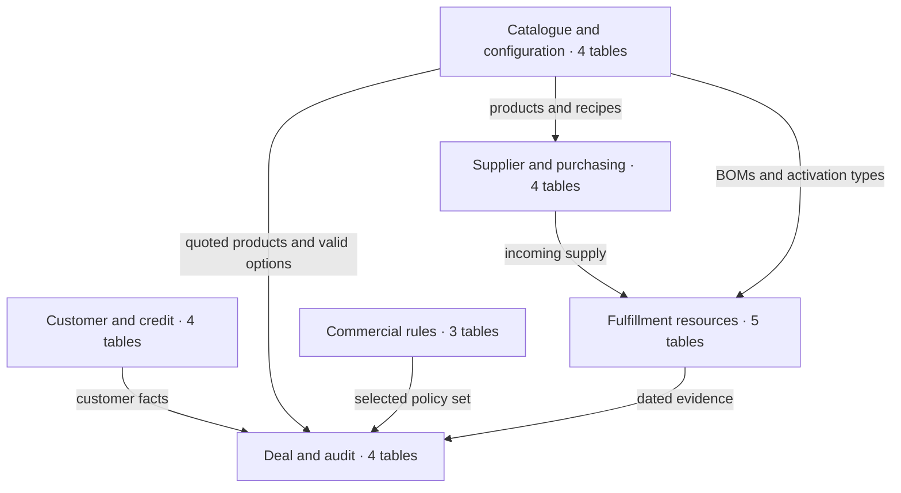
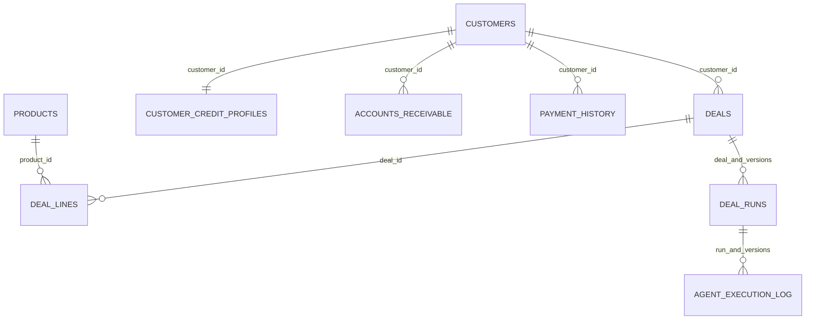
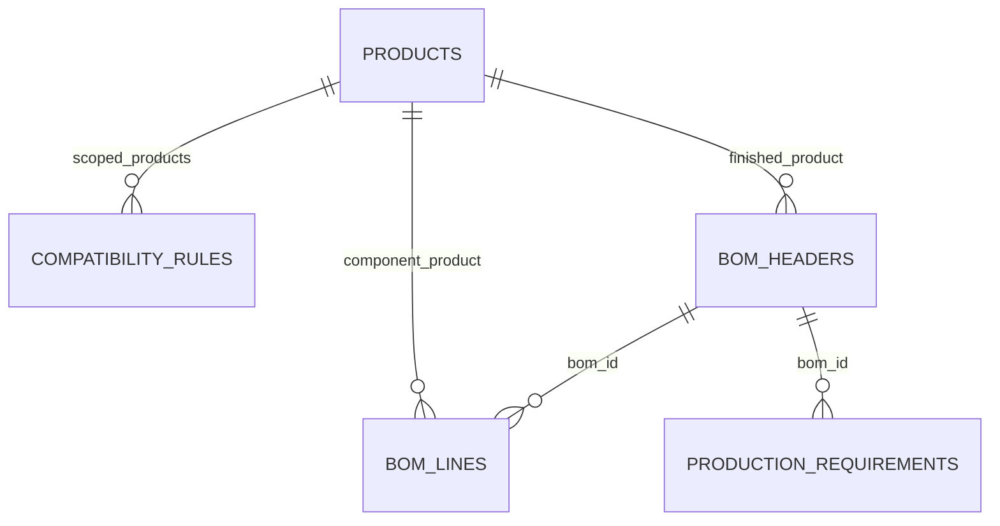
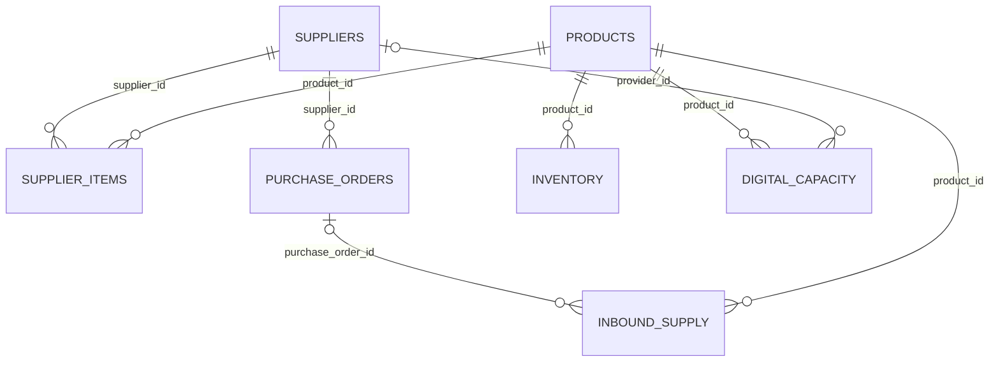
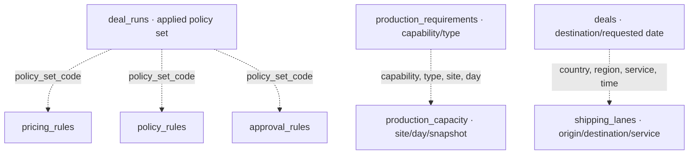

# Phase 1C — 24-table schema map

**29 September 2026 execution update.** This is a map drawn from `schema.sql`, not a database screenshot. The DDL was subsequently created successfully in the user's local PostgreSQL 18.6 test database. Read the six-area overview first; then inspect each relationship slice. Solid ERD lines below represent declared foreign keys. Rule selection and operational joins by code, configuration, location or time are explained separately because they are not all foreign keys.

## Overview: why each area exists

The arrows here describe information used during a decision. They are **not** a foreign-key diagram. One deal has lines; a run evaluates a frozen deal, and each agent attempt is logged.

| Area | Exact tables | Why separate |
|---|---|---|
| Deal and audit (4) | `deals`, `deal_lines`, `deal_runs`, `agent_execution_log` | Submission, product lines, replay context and execution attempts have different cardinality and change rules. |
| Catalogue and configuration (4) | `products`, `compatibility_rules`, `bom_headers`, `bom_lines` | Product versions/options and assembly recipes cannot be inferred from a quote alone. |
| Customer and credit (4) | `customers`, `customer_credit_profiles`, `accounts_receivable`, `payment_history` | Identity, current credit commitment, invoices and prior payments are different evidence. |
| Commercial rules (3) | `pricing_rules`, `policy_rules`, `approval_rules` | Price calculation/health, policy compliance and role routing need separate findings. |
| Supplier and purchasing (4) | `suppliers`, `supplier_items`, `purchase_orders`, `inbound_supply` | An offer, a supplier commitment and a dated free incoming quantity are not interchangeable. |
| Fulfillment resources (5) | `inventory`, `production_requirements`, `production_capacity`, `digital_capacity`, `shipping_lanes` | Physical stock, build hours, activation entitlements and transport are distinct bottlenecks. |

## A. Deal, customer and audit: declared foreign keys

The deal also has an optional `supersedes_deal_id` self-reference for resubmission. The composite run/log keys preserve policy and catalogue context; the diagram shortens their names. A draft can have zero lines while being assembled; a submitted deal must have at least one.

## B. Technical catalogue and assembly: declared foreign keys

`compatibility_rules` can have nullable source and target product references to the same `products` table. A BOM header selects a configured, versioned make-to-order product. Its lines identify component products; its requirements identify ordered production capabilities/hours.

## C. Supplier commitments and operating evidence: declared foreign keys

An inbound row may have no PO only when its separate binding evidence supports it; a supplier item is merely an offer. `quantity_allocated` on stock, inbound and digital pools represents existing commitments. A candidate quote does not create an allocation.

## D. Business-code/time joins: deliberately not foreign keys

`production_capacity` and `shipping_lanes` do not have direct FKs to a deal or BOM. A validated repository query chooses the applicable capacity snapshot and lane at run `as_of_at`. Commercial rule tables are selected using the run's applied policy-set code. The dotted arrows are *business lookups*, not database FK constraints. Pricing, policy and approval rules must be compiled/validated from the YAML before use.

**Count check:** 4 + 4 + 4 + 3 + 4 + 5 = **24** tables. The diagrams are an explanatory view; `24-table-field-and-provenance-spec-DRAFT.md` and `schema.sql` give the exact fields and constraints. DDL, smoke and 14-case row fixtures passed in local PostgreSQL 18.6; repository and agent decision validation remain pending.

## Image exports

- `Phase1C-schema-24-table-overview.png` — all 24 tables grouped by purpose.
- `Phase1C-schema-deal-and-audit.png` — quote, customer evidence, run context and commercial rule selection.
- `Phase1C-schema-assembly-and-capacity.png` — BOM components and day-level production capability.
- `Phase1C-schema-supply-paths.png` — supplier offers, PO-backed inbound, physical stock, digital pool and shipping lookup.

These are explanatory slices rather than a promise that every relationship is an SQL foreign key. `render_phase1c_schema_images.py` regenerates them from the declared table list and asserts exact 24-table coverage.
