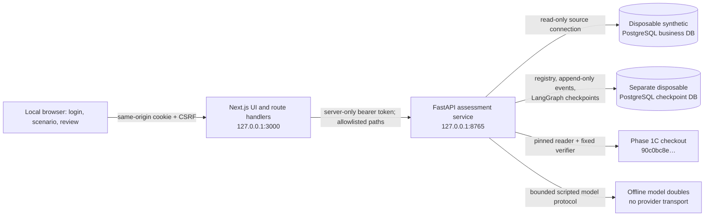
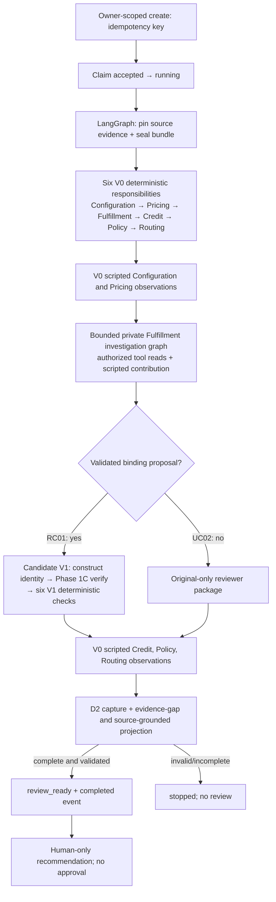

# D7 — implemented offline supervisor-demonstration architecture

**Scope and evidence.** This describes the executable tree tagged [`supervisor-demo-offline-v1`](../evaluation/supervisor-demo-d7-baseline-2026-11-09.md), **not** all capabilities in the [Phase 1B target design](../../phase-1b-agent-architecture/agent-architecture-and-deal-flow.md) or [D0 plan](../planning/supervisor-demo-plan.md). Trace code-level claims to [`orchestrator.py`](../backend/dealdesk_phase2/orchestrator.py), [`candidate_graph.py`](../backend/dealdesk_phase2/candidate_graph.py), [`assessment_service.py`](../backend/dealdesk_phase2/assessment_service.py), [`assessment_api.py`](../backend/dealdesk_phase2/assessment_api.py), [`recommendation_review.py`](../backend/dealdesk_phase2/recommendation_review.py), [D2 contract](source-grounded-recommendation-projection.md) and [D3 contract](offline-assessment-api.md). Execution is `offline_scripted` on two allowlisted synthetic scenarios, never hosted inference.

## Trust and data-flow boundaries

The [fixture setup CLI](../backend/tests/setup_assessment_api.py) installs pinned Phase 1C schema/reference/rules and the RC01/UC02 overlays **only into a newly created disposable business database**; it installs the [registry migration](../backend/migrations/001_demo_assessment_registry.sql) into a distinct checkpoint database. The running API does not install fixtures and opens business connections with `default_transaction_read_only=on` ([service](../backend/dealdesk_phase2/assessment_service.py)). The [Phase 1C adapter](../backend/dealdesk_phase2/phase1c_adapter.py) checks the exact source commit, seals source identity and delegates fixed candidate verification to that checkout. Source read, checkpoint, registry and public DTO have different authority; neither a model-generated field nor an event count is itself a business decision.

## Actual LangGraph execution (one assessment)

The original synchronous `StateGraph` in [`build_original_graph`](../backend/dealdesk_phase2/orchestrator.py) pins an immutable run context, computes the Phase 1C fixed decision once, maps six fixed specialist responsibilities, reconciles status and withholds Routing when required. A private, bounded [`investigation_graph.py`](../backend/dealdesk_phase2/investigation_graph.py) uses an authorized Fulfillment tool ledger; its model/tool calls are not browser-token streaming. [`AssessmentService.run`](../backend/dealdesk_phase2/assessment_service.py) then executes the Configuration/Pricing and Credit/Policy/Routing offline model protocols around Fulfillment. The six `ai_completed` events refer to **original V0** slots. Each event is recorded after its respective persisted boundary, not as a claim that the finding is favorable. [D3](offline-assessment-api.md) documents event ordering and response shapes.

| Responsibility | Implemented fixed-versus-scripted boundary in this demo |
| --- | --- |
| Configuration | Fixed product/configuration mapping; separately labeled scripted inspection/citation on V0. |
| Pricing & margin | Fixed calculations; separately labeled scripted V0 observation. No AI-computed margin is authoritative. |
| Fulfillment | Fixed availability/shortage; scripted RC01 hypothesis from inspected authorized sources; the pinned verifier must accept the exact proposed slices. UC02 abstains without a candidate. |
| Credit & risk | Fixed evidence-based result; scripted V0 observation is **not** clearance. UC02 fixed Credit is `unknown` with stale/unavailable evidence. |
| Policy & compliance | Fixed rule IDs (including late delivery); scripted V0 observation cannot waive a rule. |
| Approval Routing | Fixed route/roles mapping; scripted V0 observation cannot grant approval. Withheld roles serialize as `null`, not an empty list. |

### V0, optional V1 and review

RC01 preserves the original V0 request (10 units by 4 September 2026). The scripted Fulfillment hypothesis is 8 on 3 September plus 2 on 8 September, citing inventory/inbound records. [`candidate_graph.py`](../backend/dealdesk_phase2/candidate_graph.py) checks the proposal's subject/source/attempt identity, constructs **one** isolated V1, invokes `Phase1CAdapter.verify_candidate`, and maps **six deterministic V1 results**. V1 is `fixed_checked`, supply is `supply_supported_unreserved`, but original and candidate business status remain `needs_revision`: the customer has not accepted the later two units, no stock is reserved, and Routing remains withheld. The original request is not overwritten. UC02 returns `candidate: null` and `candidate_comparison: null` and cannot be described as a successful alternative. These are implemented examples, not a general multi-candidate solver. See [D2's typed review and exact fields](source-grounded-recommendation-projection.md).

[`project_source_grounded_review`](../backend/dealdesk_phase2/recommendation_review.py) is a read-only, allowlisted `source-grounded-review-v1` projection. It checks complete V0 slots, source/candidate lineage, bound citations, six V1 fixed checks where applicable, evidence gaps and the human-only action. [`AssessmentService.review`](../backend/dealdesk_phase2/assessment_service.py) checks owner-scoped registry status, sealed bundle/source digests and run/subject IDs, reopens the LangGraph checkpoint, rejects pending nodes, then **rereads current business source** to fail closed on drift before projecting. This is not a provider receipt or a new assessment. The API serves no raw checkpoint, rejected model text or private credit ledger.

## API, frontend and recoverability

The [FastAPI service](../backend/dealdesk_phase2/assessment_api.py) accepts only `B01/RC01` and `N01/UC02` on `127.0.0.1:8765`: `POST /demo/assessments` and owner-scoped `GET /demo/assessments/{id}`, `/events?after=`, `/review`. A bearer token identifies the configured owner; IDs and request sizes are bounded, the Host is restricted, errors are sanitized, and review returns `409` if not ready or inconsistent. A single process has an advisory lock and one worker. [`AssessmentStore`](../backend/dealdesk_phase2/assessment_store.py) owns transactional per-owner idempotency, claim, append-only ordered events and startup transition of orphaned `accepted`/`running` rows to `uncertain`. Same-key retries return the same ID, **not a new execution**. `stopped` and `uncertain` are terminal for this run; neither API startup nor a browser refresh automatically replays reserved or possibly-sent actions. `completed` status is revalidated against source and checkpoint, not inferred from a finished worker alone.

Next.js exposes a landing and assessment workspace through [`frontend/`](../frontend/README.md). Its [auth handlers](../frontend/lib/security.ts) use an HMAC-signed, HttpOnly, SameSite=Strict local session, login/session CSRF and exact Origin for mutations. Its [backend-for-frontend](../frontend/lib/backend.ts) constructs only fixed loopback Python routes server-side, keeps the bearer token out of the browser, and rejects nonconforming [DTOs](../frontend/lib/contracts.ts). UI polling checks contiguous persisted event cursors and obtains a completed review before showing a decision; error states clear previously displayed decisions. Technical trace is a keyboard-operable disclosure. Cookie `Secure=false` is **local HTTP only**, not a public-deployment design. See [D4 setup/security](../frontend/README.md), [D5 QA](../evaluation/supervisor-demo-d5-quality-assurance-2026-11-08.md) and [D6 security review](../evaluation/supervisor-demo-d6-rehearsal-2026-11-08.md).

**Implemented versus proposed:** implemented here are scripted V0 specialist protocols, one optional Fulfillment-derived V1 with six fixed checks, source-grounded human review and a disposable loopback UI/API. Not implemented: paid/hosted execution in this demo, V2/multiple candidates, candidate-specific AI reassessment, live ERP integration, general-user auth/deployment, customer acceptance, stock/production reservation, policy waiver, final human approval or independent specialist-accuracy measurement. Historical hosted development experiments elsewhere in the repository are separate and are **not** evidence of hosted execution in this baseline.
