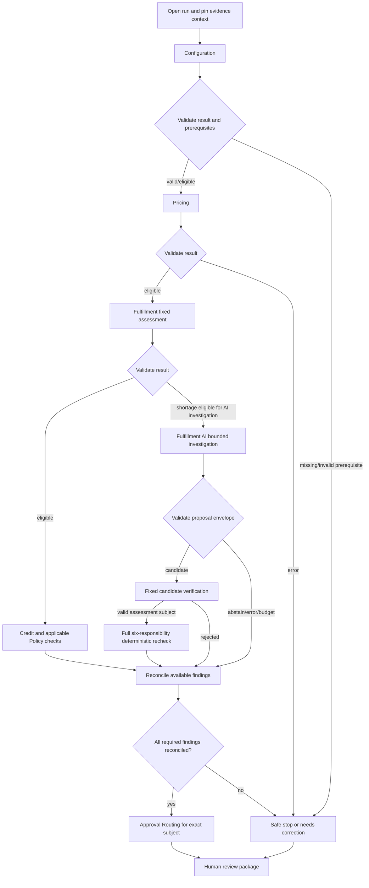

# Workshop 2 — LangGraph state, evidence, checkpointing and transitions

**Status:** W2.1–W2.4 approved as architectural directions by the user on 18 October 2026 in the architecture discussion; precise interfaces and implementation mechanisms remain provisional. **No implementation authorization is implied.** This document elaborates Workshop 1 D1–D3, not a change to the approved Phase 1B business architecture or Phase 1C data/rule ownership.

## Purpose and teaching example

A salesperson submits a deal for 20 configured units requested by Friday, with partial delivery permitted. Configuration checks sellability first. Fixed dated supply evidence supports 12 units by Friday and identifies a possible later eight units subject to supplier confirmation. Fulfillment AI may investigate permitted supply paths, propose a 12+8 split, explain the missed all-by-Friday requirement and conditional supplier commitment, or abstain. The proposal is unverified until deterministic checks validate its structure and business facts. The Orchestrator controls execution, not deal approval.

Workshop 1 established **what** the Orchestrator must do. Workshop 2 establishes the **design direction for how LangGraph will coordinate it**, with four decisions:

| ID | Decision | Status |
| --- | --- | --- |
| W2.1 | One typed authoritative assessment state, isolated specialist input/output projections and optional private agent/subgraph working state | Approved direction |
| W2.2 | Version-pinned evidence context with controlled discovery of additional eligible records, traceable provenance and no silent refresh | Approved direction; exact consistency mechanism open |
| W2.3 | PostgreSQL-backed LangGraph checkpointing from M1, using isolated thesis resources and safe resumption | Approved direction; schema/package/setup open |
| W2.4 | Explicit conditional graph transitions, post-specialist validation, bounded candidate loops and fail-safe terminal paths | Approved direction; exact nodes/edges open |

## W2.1 — Authoritative typed assessment state

A LangGraph **node** is an execution step (for example Configuration, Fulfillment, candidate verification, result validation). **State** is the structured assessment record exchanged between steps. The state is not the database and is not a license for agents to read every field.

**Logical state compartments (not yet finalized Python type names):**

1. **Immutable run context:** run ID, original deal ID, original submission reference, as-of time, dataset/evidence version, source manifest or fingerprint, catalogue/policy/rule versions and contract version.
2. **Subject identity:** original versus candidate, candidate ID, parent candidate, exact proposed field changes; original never overwritten.
3. **Per-subject outputs:** specialist result envelopes, deterministic findings, candidate verification and human routing results, all keyed to the exact subject and version.
4. **Workflow control:** completed/ready/blocked/invalidated dependencies, last transition, pending operations, terminal state and reason.
5. **Candidate register:** unverified proposals, verification results, evidence references, assumptions, conditional commitments, unmet constraints, revisions and comparison links.
6. **Trace and budgets:** tool/model invocations and their bounded metadata, execution failures, retry/proposal counters, timestamps and provenance.
7. **Review package:** reference or structured representation of the final original-versus-candidate comparison, including withheld routes and missing evidence.

**Isolation rules:** The Orchestrator owns workflow state transitions and validates node results before accepting them. Specialists receive minimal, versioned, domain-specific input projections and return typed outputs. They cannot arbitrarily mutate another specialist's result, the original deal or the run context. Private temporary state within a specialist/subgraph is allowed where useful; six separately persistent agent lifecycles are not required for M1.

**Implementation candidates, not yet approved signatures:** Python typed models for immutable context and specialist results; LangGraph state with controlled reducers/updates where necessary; stable subject keys to prevent a candidate from overwriting original results. Avoid using a single freely mutable dictionary. Define merge behavior explicitly if parallel execution is later introduced.

**Invariants/tests to write later:** reject run/snapshot/subject mismatch; reject overwriting original; reject unauthorized specialist fields; ensure two candidate results remain separate; verify checkpoint serialization/reload preserves identities and budgets.

## W2.2 — Frozen evidence version with controlled discovery

**Why this matters for this thesis:** Synthetic operational data is not currently a live ERP feed; spontaneous inventory changes during a short run are not the primary M1 risk. Reproducibility, dated evidence correctness, candidate rechecks and the ability to prove which facts an AI saw are primary.

**Approved principle: freeze the evidence version, not necessarily the initial list of records.** At run creation, identify the source dataset/manifest and dated assessment context. Each authorized specialist tool may retrieve *additional relevant* records, but only from that same context. Log every discovered record and its provenance. Never silently mix versions. Material evidence refresh creates a newly identified assessment context.

**Distinct concepts:**
- **Business as-of time:** filters facts by their effective/recorded dates under Phase 1C's actual dated-reader rules.
- **Database transaction snapshot:** determines visible PostgreSQL row versions within a transaction; storing a timestamp does not recreate the same MVCC snapshot in a later transaction.
- **Dataset/manifest version and source fingerprint:** support provenance and replay only if the underlying referenced rows or artifacts are retained and immutable or reconstructable.
- **Agent-visible evidence projection:** the restricted set of selected records exposed through named tools, not direct SQL or database credentials.

**Proposed M1 sequence, subject to Phase 1C interface verification:**
1. Open a read-only consistent PostgreSQL read through the Phase 1C reader; identify run/as-of/version context and relevant initial evidence.
2. Persist sufficient version/manifest information to re-access the same immutable source material, or preserve a small canonical evidence payload where required by the real interface. Do not assume a hash alone is enough.
3. Make all agent tools check that each returned record belongs to the pinned context; record source ID, dated fields, version/fingerprint and access event.
4. On additional evidence discovery, use the same pinned context and revalidate eligibility. Do not interpret a newly discovered record as a new dataset version.
5. Verify candidates using facts from that same context. If exact reconstruction is impossible, fail safely and require a new run/context rather than silently querying newer facts.
6. Test reproducibility by replaying original and candidate checks after a database mutation or process restart, and by deliberately injecting a mismatched version.

**Explicit unresolved design choice:** Phase 1C's real reader, manifest and persistence behavior must be audited to decide between (a) immutable dataset/manifest replay, (b) a canonical per-run evidence artifact/bundle, or (c) a compatible hybrid. The approved architecture does **not** require copying the entire database or introducing a new storage service. A long-lived PostgreSQL transaction spanning model calls is not the default: it is fragile across waits/restarts. Any evidence-bundle storage details require specification and tests.

## W2.3 — PostgreSQL-backed LangGraph checkpointing

**Approved:** Use LangGraph with PostgreSQL persistence for workflow checkpoints from M1. PostgreSQL is an already agreed technology; do not silently introduce Redis, a queue, another database, a hosted tracing service or a paid API.

**What a checkpoint does:** Stores resumable graph execution state, so a model/tool interruption need not force all completed steps to rerun. **What it does not do:** It does not by itself freeze PostgreSQL business evidence, establish correctness of source references, or make external side effects safe.

**Safety requirements:**
- Use a separate thesis database or appropriately isolated schema/credentials. Never touch or disrupt the unrelated Odoo/n8n services on the Oracle VM.
- Map the checkpoint execution/thread identity to a stable assessment run and preserve the exact run context, subject IDs, version pins and budgets.
- Validate checkpoint schema/version and frozen-evidence availability before resuming.
- Record attempted/completed operations and guard against duplicate candidate creation or duplicate model/tool actions after retries; all M1 tools remain read-only or deterministic verification, never business mutation.
- Bound retries and execution; a resume cannot reset the proposal/retry budget or silently fetch newer evidence.
- Keep secrets/credentials out of checkpoint payloads; define retention, access permissions and safe handling of sensitive or customer-like records.
- Demonstrate restart after Configuration, during candidate investigation and before final packaging; compare output identity, trace and business results with uninterrupted execution.

**Open technical details:** compatible LangGraph/checkpointer package versions, checkpointer initialization/migrations, connection configuration, schema isolation, checkpoint retention/cleanup, serialization format and restore semantics. Installation and VM commands will be explained before execution; any material new technology or cost requires explicit user approval.

## W2.4 — LangGraph conditional transitions and post-agent evaluation

**Approved:** The Orchestrator evaluates **after every specialist execution**, and performs a separate overall reconciliation once applicable checks are complete.

**Post-specialist gate (execution correctness, not independent business judgment):**
1. Check execution status, typed schema and allowed agent identity.
2. Check run/deal/candidate ID, contract/rule/evidence versions and source provenance.
3. Check mandatory references and output semantics, using deterministic validators where needed.
4. Update the exact subject's result and dependency status; reject or quarantine malformed/mismatched output.
5. Choose the next eligible node, bounded retry, evidence-needed path or safe stop.

A business finding such as shortage does **not** automatically abort the run. The Orchestrator may still investigate a permitted alternative. A missing prerequisite may block *dependent* checks without discarding independently valid findings.

**Conceptual graph (not finalized LangGraph API):**

**Diagram limitations:** This is a teaching view, not a rigid order that forces all Policy checks to wait for every other specialist. The final graph must encode the exact Phase 1B prerequisites and avoid skipping Credit/Policy on the original when AI investigation branches. Configuration is first; Pricing precedes Credit; Fulfillment requires valid configuration; applicable Policy checks use their actual dependencies; Routing waits for required reconciled results. The Orchestrator is not a seventh approving business agent.

**Candidate lifecycle:** Proposed/unverified -> schema and evidence validation -> fixed verification -> rejected, unknown/conditional or eligible-for-assessment -> full deterministic six-responsibility recheck for M1 -> candidate-specific routing/review when prerequisites allow. Do not call a structurally valid candidate confirmed or approved. Original and candidate findings stay separate; Routing recomputes for the exact subject. Later selective reuse requires verified fingerprints and tests.

**Limits:** Provisional M1 defaults inherited from D3: at most two distinct proposals, one revision level, one retry for eligible transient failures; configurable time and tool budgets still open. Every loop needs an explicit termination guard. Do not retry genuine rule violations hoping for a pass.

**Failure paths:** Model unavailable/timeout -> bounded idempotent retry then retain fixed original findings; invented evidence or malformed proposal -> reject candidate and record trace; missing/stale evidence -> unknown/needs evidence; run/version mismatch -> fail safely; conflicting authoritative facts -> fixed recheck or unresolved human handoff; hard customer constraint -> no unsupported candidate; AI abstention -> no candidate, preserve original. Unresolved required checks withhold an ordinary executable route.

**Human output:** Present original assessment, each considered candidate and status, exact differences, unmet requested date/other constraints, conditional supplier commitment, evidence IDs/dates, unknowns, required human roles (if derivable), withheld routing and reasons, and a reproducible trace. No autonomous approval, waiver, stock reservation, production booking or delivery promise.

## Proposed technical acceptance matrix (test design, not completed tests)

| Test scenario | Expected behavior |
| --- | --- |
| Configuration invalid | Downstream dependent checks blocked; explicit correction/review path |
| Valid original; no shortage | No gratuitous AI candidate investigation |
| 20 requested, 12 dated support, eight conditional later | Candidate remains conditional; Friday full request remains unmet |
| AI returns no suitable alternative | Original fixed assessment preserved; no invented proposal |
| AI cites unselected or wrong-version record | Reject/quarantine claim and record reason |
| Candidate quantities total 19 or 21 | Fixed validation rejects it |
| Candidate fails indivisible-group rule | Fixed validation rejects it |
| Candidate accepted for assessment | Full six-responsibility deterministic recheck, isolated candidate results |
| Pricing/Policy/Credit result mismatched to subject | Orchestrator rejects and prevents ordinary routing |
| Model timeout | Bounded retry; safe incomplete AI path; no favorable inference |
| Restart after checkpoint | Same pinned run/subject/evidence context and remaining budgets |
| Dataset changes between reads | Existing run never silently consumes new-version evidence |
| New eligible record discovered within same pinned dataset | Authorized tool may return it with provenance and trace |
| Critical evidence cannot be reconstructed | Safe stop or new identified run, never silently use current rows |
| Required result unknown/conflicting | Human review records unresolved issue; ordinary executable route withheld |
| Candidate loop reaches limit | Deterministic termination with trace and original preserved |

## Interfaces and decisions still open

- Actual Phase 1C reader/manifest/version/candidate APIs and the integration approach for diverged draft PR #1.
- Exact LangGraph state type, reducers, graph nodes, edge predicates and checkpoint identity.
- Durable evidence replay versus small canonical per-run evidence bundle; immutable storage/retention semantics.
- PostgreSQL checkpoint package versions, schema isolation, connection setup, restore and cleanup.
- Exact typed candidate status enum, agent envelopes, tool allowlists and evidence-reference validation.
- Precise per-node timeouts, token/tool-call limits, retry classification and human-package schema.
- Independent evaluation cases and accepted answer keys; no thesis accuracy claim before independent acceptance.
- Parallel execution only after correctness and latency measurement.
- Material technology changes require explicit user approval under TG1.

## Next workshop and repository boundaries

**Workshop 3:** Verify the actual Phase 1C interfaces and design specialist input/output types, read-only tool signatures, candidate proposal/verification contracts and failure cases. Do not represent draft PR #1 as merged into Phase 2. Keep Phase 1C data generation, rules and evaluation-answer ownership separate. This workshop adds documentation only; no agent code, database migration, dependency installation or infrastructure change.
